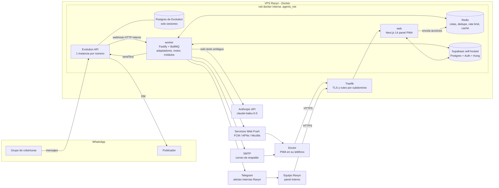
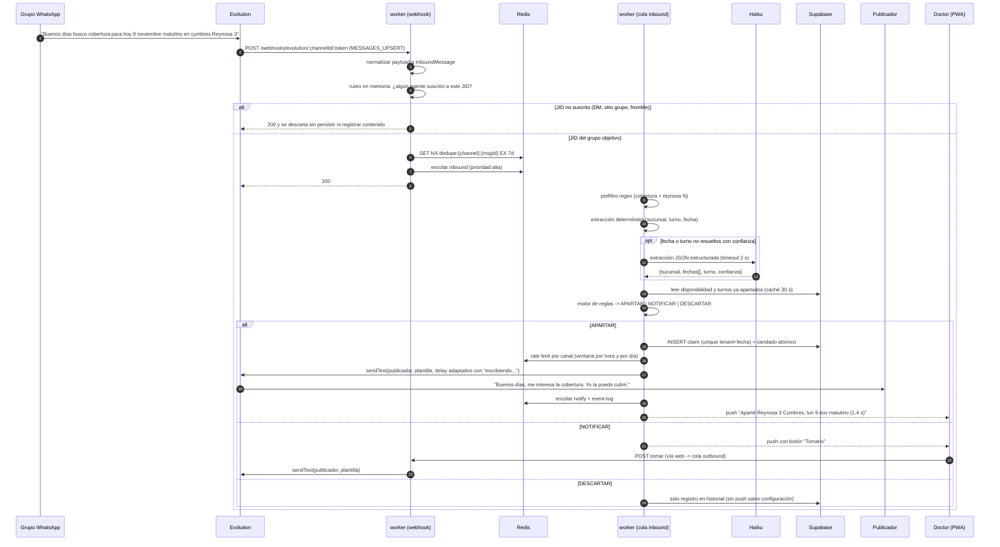
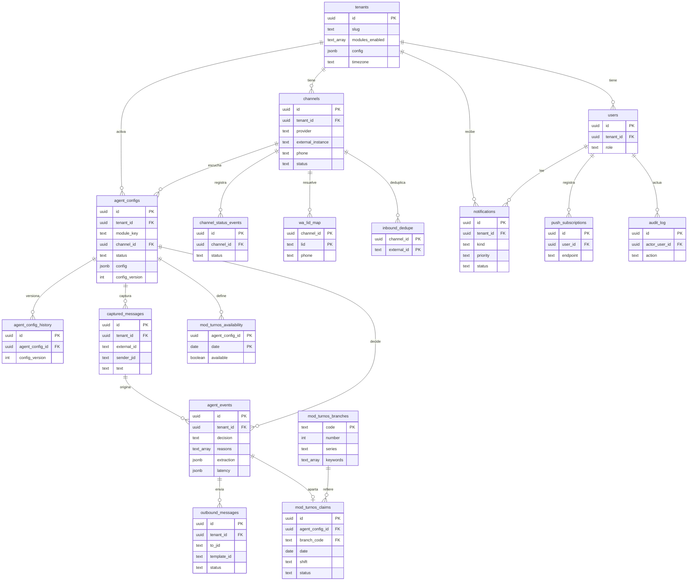
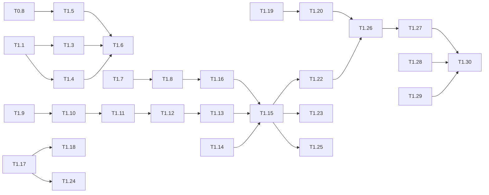

# Plataforma de Agentes de WhatsApp (Ravyn Studio) — Plan de Implementación

Versión 1.0 · 2026-11-11 · Autor: arquitectura Ravyn Studio
Primer tenant: médico de coberturas en farmacias Similares de Reynosa. Primer módulo: **Apartador de turnos**.

Convenciones de este documento:
- **[DECISIÓN ASUMIDA]**: decisión tomada por el arquitecto sin confirmación explícita, con su justificación. Se puede revertir; el plan indica el costo de hacerlo.
- **[CONFIRMAR CON CLIENTE]**: dato que solo el doctor puede dar. Tiene un valor por defecto para no bloquear el desarrollo.
- Las tareas (sección 14) usan IDs `T<fase>.<n>` y están pensadas para que cada una quepa en una sesión de Claude Code.

---

## 0. Respuestas recibidas y su impacto

| # | Pregunta | Respuesta | Impacto en el plan |
|---|---|---|---|
| 1 | Reglas del doctor | Solo turno **matutino**; 15 sucursales aceptadas (lista en 7.4); nunca dos turnos el mismo día; si piden varios días, decide el doctor | Motor de reglas: turno permitido = matutino, un turno por día como restricción de base de datos, multi-día = notificar |
| 2 | Número | Número **personal**, el mismo que usa para todo (incluye pacientes) | Privacidad y riesgo de bloqueo son máximos. Ver 11.2 y riesgo R1. No se persiste nada fuera del grupo objetivo |
| 3 | Calendario | Sin Google Calendar: disponibilidad administrada desde el panel | Se elimina la integración con Google en la fase 1. Tabla propia de disponibilidad. Menos latencia y menos dependencias |
| 4 | Después del DM | Solo decir que está interesado; el doctor sigue a mano | El agente envía un único mensaje. No se procesan respuestas privadas (además, por privacidad, no podríamos) |
| 5 | Avisos | PWA con notificaciones push desde el inicio | Web Push con VAPID, service worker, instalación en pantalla de inicio. Correo como respaldo |
| 6 | Convenciones | Repo `ravyn-crm` | Se replican: Next.js 14.2, `@supabase/ssr`, cliente admin con service role, contexto de tenant con filtro explícito, Tailwind + shadcn/ui (Radix), Zod 4, react-hook-form, npm, documentos en español |
| 7 | VPS | Capacidad holgada (40+ contenedores, 5+ instancias de Supabase, menos del 50 % de uso) | Supabase **self-hosted** dedicado, Redis y Evolution en el mismo VPS |
| 8 | Dominio | `ravyn-crm.cloud` (la raíz hoy apunta a otro repo) | Panel en el subdominio `app.ravyn-crm.cloud` durante la fase 1 (ver D-08) |
| 9 | Aviso de privacidad | Incluirlo | Sección 11.5 con contenido mínimo y cláusulas de contrato |
| 10 | Ejecución | Solo sesiones de Claude Code | Tareas pequeñas, con archivos objetivo y criterio de aceptación verificable por comandos |

### 0.1 Hallazgo crítico en el catálogo de sucursales

Al cruzar la lista del doctor con los dos PDF se ve que **el número de sucursal no es único**. Hay dos series:

- **Serie S** (claves `S-xxxx`, nombre oficial "REYNOSA N"): 36 sucursales, de la 1 a la 38.
- **Serie F** (claves `F-`, `FC-`, `FH-`, nombre oficial "REYNOSA N, TMS"): 49 sucursales, de la 2 a la 52.

Casi todos los números del 2 al 38 existen **dos veces**, en colonias distintas. De las 15 sucursales que acepta el doctor, 10 tienen una "gemela" con el mismo número que él **no** aceptó (por ejemplo, Reynosa 3 Cumbres `S-0404` frente a Reynosa 3 TMS en Benito Juárez `FC-1228`). Los mensajes del grupo a veces incluyen la colonia ("cumbres Reynosa 3", "Reynosa 52 pirámides") y a veces no ("Reynosa 51").

Consecuencia: la regla "¿la sucursal es aceptada?" no se puede decidir solo con el número. El plan introduce un **resolvedor de sucursal** (7.5) que usa número y palabras clave de colonia, y una **política de ambigüedad** configurable. Es el punto que más afecta la tasa de apartados automáticos, así que va primero en las decisiones abiertas.

El catálogo completo, ya extraído de los PDF, está en `docs/anexos/sucursales-reynosa.csv` y sirve como semilla de datos (T1.9).

---

## 1. Resumen ejecutivo y alcance

### 1.1 Qué se construye

Una plataforma multi-tenant (un código y un despliegue) donde Ravyn da de alta clientes, conecta sus números de WhatsApp y activa módulos de agente configurables. El cliente ve un panel PWA ligero con solo lo que contrató.

El primer módulo, **Apartador de turnos**, escucha un único grupo de WhatsApp. Detecta publicaciones de "busco cobertura", extrae sucursal, fecha y turno, aplica las reglas del doctor y, si todo cumple, le escribe por privado a quien publicó en menos de 3 segundos con un mensaje humano y variado. Si no cumple o hay duda, avisa al doctor con una notificación push y un botón para tomar el turno.

### 1.2 Decisiones de arquitectura principales

1. **El núcleo de agentes va en código** (Node.js + TypeScript, Fastify + BullMQ), no en n8n. n8n queda para integraciones auxiliares. Justificación en 2.3.
2. **Supabase self-hosted** en el VPS de Ravyn, en una instancia dedicada. Justificación en 10.1.
3. **RLS activado en todas las tablas, sin políticas (todo denegado)**, como segunda capa sobre el aislamiento en aplicación. No reabre el principio 7: lo complementa y corrige un riesgo real. Justificación en 11.1.
4. **Camino rápido sin LLM**: regex y un parser de fechas determinista resuelven el caso común. Haiku solo entra cuando el texto es ambiguo. Latencia típica sin LLM: de 1.0 a 1.6 s; con LLM: de 1.7 a 2.8 s.
5. **Modo observación** antes de activar envíos reales: durante 5 a 7 días el agente solo avisa "habría apartado esto" para medir la precisión con mensajes reales.

### 1.3 Fases

| Fase | Objetivo | Resultado verificable |
|---|---|---|
| **Fase 0. Fundaciones** | Monorepo, base de datos, autenticación, esqueleto de despliegue | `app.ravyn-crm.cloud` responde con login; worker sano; migraciones aplicadas con RLS |
| **Fase 1. MVP Apartador** | Primer cliente en producción | El doctor recibe DMs automáticos y avisos push; panel con estado, QR, disponibilidad, configuración, historial y avisos; panel interno para dar de alta |
| **Fase 2. Endurecimiento y segundo tenant** | Hacer reutilizable lo construido | Adaptador de Meta Cloud funcional, Chatwoot opcional por tenant, políticas RLS por tenant, Realtime, formulario de configuración genérico |
| **Fase 3. Catálogo de módulos** | Extraer módulos y escalar | Alta guiada de tenants, plantillas de módulos, facturación interna y métricas por cliente |

### 1.4 Fuera de alcance (explícito)

En la **fase 1** no se hace:
- Bandeja tipo WhatsApp Web ni lectura de chats privados. Se integrará Chatwoot en la fase 2, solo donde haga falta, y nunca en este tenant mientras use su número personal.
- Integración con Google Calendar (la disponibilidad se lleva en el panel).
- Conversación automática después del primer DM. El agente no responde mensajes privados.
- Detección automática de "ya se cubrió" o de la confirmación del publicador.
- Adaptador de Meta Cloud API funcional (solo un stub que compila y pasa las pruebas de contrato).
- Autoservicio: el cliente no crea cuentas, módulos ni canales.
- Telegram como canal de avisos al cliente (sí se usa para alertas internas de Ravyn).
- Facturación y cobro.
- Aplicación nativa (la PWA cubre Android y iOS 16.4+).

---

## 2. Arquitectura

### 2.1 Componentes



Notas:
- **Evolution no se expone a internet** salvo su manager, que va detrás de Traefik con autenticación básica y lista de IPs permitidas. El webhook de Evolution al worker viaja por la red interna de Docker (`http://worker:3001/...`), así que el contenido de los mensajes nunca sale del host.
- **El worker es el único que habla con los proveedores de canal.** El panel web nunca llama a Evolution directamente: encola trabajos en Redis (BullMQ) o llama a la API interna del worker.
- Se usa un único servicio `worker` en la fase 1. Sus colas están separadas y, si hace falta, se puede escalar a varias réplicas por cola sin cambiar código.

### 2.2 Flujo de un mensaje de punta a punta



### 2.3 Núcleo en código frente a n8n

| Criterio | Núcleo en código (Fastify + BullMQ) | Núcleo en n8n |
|---|---|---|
| Latencia | Proceso caliente, regex en microsegundos, de 2 a 5 ms por salto a Redis | Cada ejecución arranca un workflow; con el modo cola y la persistencia de ejecuciones son de 50 a 300 ms extra, y variables |
| Pruebas | Vitest con los mensajes reales, fixtures de webhooks, reloj controlado y CI | Difícil de probar unitariamente; no hay forma práctica de fijar el reloj ni de versionar cambios finos |
| Privacidad | Control total de qué se registra; los mensajes descartados no tocan disco | n8n guarda los datos de cada ejecución (configurable, pero fácil de equivocar); el payload de un DM de paciente podría quedar en el historial de ejecuciones |
| Multi-tenant y módulos | Registro de módulos tipado, esquemas Zod y un solo despliegue | Un workflow por tenant tiende a convertirse en forks por cliente, lo que viola el principio 2 |
| Versionado | git, revisión y migraciones | Exportar JSON; los diffs son ilegibles |
| Velocidad para prototipar integraciones | Media | Alta |

**Decisión:** el núcleo (adaptadores, motor y módulos) va en código. n8n queda para integraciones auxiliares que no están en el camino crítico ni manejan mensajes: por ejemplo, un reporte semanal por correo o una sincronización con el CRM. Si se usa n8n contra PostgREST, los filtros van en la URL y no en el panel de query params (por el bug de re-encoding de `eq.`).

### 2.4 Estructura del repositorio

Monorepo con **npm workspaces**, igual que el gestor de `ravyn-crm`.

```
shiny-journey/
  apps/
    web/                    Next.js 14 (App Router): panel del cliente, panel interno, PWA
    worker/                 Fastify (webhooks, API interna) + BullMQ (colas) + schedulers
  packages/
    core/                   tipos de dominio, TenantContext, registro de módulos, motor de agentes
    channels/               interfaz ChannelAdapter, Evolution, Meta Cloud (stub), Fake (pruebas)
    db/                     cliente admin de Supabase, tipos generados, helper tenantTable()
    llm/                    wrapper de Anthropic: extractJson() con Zod, timeout, métricas, presupuesto
    notify/                 web push (VAPID), correo SMTP, Telegram interno
    config/                 eslint, tsconfig base, vitest base
  modules/
    apartador-turnos/
      src/definition.ts     ModuleDefinition (esquema, disparadores, acciones)
      src/server/           pipeline: prefilter, extract, resolve, rules, act
      src/ui/               manifiesto de navegación y textos (seguro para el cliente)
      src/templates.ts      pool de mensajes
      fixtures/             mensajes reales y webhooks de ejemplo
  supabase/
    migrations/             SQL versionado (YYYYMMDDHHMM_nombre.sql)
    seed/                   catálogo de sucursales, tenant de desarrollo
  infra/
    docker-compose.yml      servicios de la plataforma
    traefik/                labels y middlewares
    env/                    *.env.example por servicio
    scripts/                backup, restore, actualización de Evolution
  scripts/
    simulate-webhook.ts     harness de webhooks
    eval-extractor.ts       evaluación del extractor con la API real (opcional)
  docs/
```

Convenciones heredadas de `ravyn-crm`:
- `lib/supabase/{server,client,admin,auth}.ts` en `apps/web` con la misma forma. `getTenantContext()` sustituye a `getClinicContext()` y devuelve `{ supabase, db, user, profile, tenantId, role }`.
- Route handlers en `app/api/**/route.ts`, siempre con `ctx` y respuestas `{ error }` y códigos 401/400/500.
- UI con shadcn/ui (Radix), Tailwind, `lucide-react`, `sonner` y temas con variables CSS (como `var(--sidebar-bg)` en `ravyn-crm`), que aquí se alimentan de la marca del tenant.
- Sin emojis en código, comentarios ni documentos técnicos (regla de `docs/AGENT_INSTRUCTIONS.md` de `ravyn-crm`).

Diferencias justificadas:
- **Vitest** (`ravyn-crm` no tiene pruebas). La regla de oro del extractor es la cobertura de pruebas.
- **El worker no usa Next.js.** Un proceso de larga vida con conexiones a Redis y webhooks no encaja con route handlers.
- **Las consultas tenant-scoped pasan por un helper** `tenantTable(ctx, "tabla")`, que aplica `.eq("tenant_id", ctx.tenantId)` en select, update y delete, e inyecta `tenant_id` en insert. Sigue siendo aislamiento en aplicación (principio 7), pero el filtro no depende de que alguien se acuerde de escribirlo. Además, una regla de lint (o prueba con grep en CI) prohíbe `.from(` directo sobre tablas con `tenant_id` fuera de `packages/db`.

---

## 3. Modelo de datos

Convenciones: `uuid` con `gen_random_uuid()`, `timestamptz` con `now()`, nombres en snake_case e inglés para las tablas de plataforma (como en `ravyn-crm`). Las tablas propias de un módulo llevan el prefijo `mod_<clave_corta>_`. Todas las tablas tienen **RLS activado sin políticas** (ver 11.1).

### 3.1 Tablas de plataforma

**tenants**
| Columna | Tipo | Notas |
|---|---|---|
| id | uuid PK | |
| slug | text UNIQUE NOT NULL | `dr-x`; se usa en URL de manifest y logs |
| name | text NOT NULL | nombre comercial |
| status | text NOT NULL | `active`, `paused`, `offboarding` |
| modules_enabled | text[] NOT NULL default `'{}'` | claves de módulo; validadas contra el registro en código |
| config | jsonb NOT NULL default `'{}'` | marca y preferencias generales (esquema `TenantConfigSchema`, ver 4.5) |
| timezone | text NOT NULL default `'America/Matamoros'` | |
| created_at, updated_at | timestamptz | |

**users** (perfil, `id` = `auth.users.id`, igual que en `ravyn-crm`)
| Columna | Tipo | Notas |
|---|---|---|
| id | uuid PK FK auth.users | |
| tenant_id | uuid FK tenants NULL | NULL solo para personal de Ravyn |
| full_name | text NOT NULL | |
| role | text NOT NULL | `ravyn_admin`, `ravyn_ops`, `tenant_owner`, `tenant_member` |
| email | text NOT NULL | copia para avisos de respaldo |
| created_at | timestamptz | |
| CHECK | | `(role LIKE 'ravyn_%') = (tenant_id IS NULL)` |

**channels** (un número conectado)
| Columna | Tipo | Notas |
|---|---|---|
| id | uuid PK | |
| tenant_id | uuid FK NOT NULL | |
| provider | text NOT NULL | `evolution`, `meta_cloud` |
| external_instance | text UNIQUE NOT NULL | nombre de la instancia en Evolution (`t-<slug>-<n>`) o `phone_number_id` de Meta |
| phone | text NULL | `521XXXXXXXXXX`, se llena al conectar |
| status | text NOT NULL | `pending_qr`, `connecting`, `open`, `closed`, `logged_out`, `error` |
| status_changed_at | timestamptz | |
| last_inbound_at | timestamptz | último webhook de un JID suscrito (heartbeat de negocio) |
| webhook_token_hash | text NOT NULL | sha256 del token de la ruta del webhook |
| settings | jsonb NOT NULL default `'{}'` | límites de envío y opciones del proveedor |
| created_at | timestamptz | |
| Índices | | `(tenant_id)`, `(status)` |

**channel_status_events** (bitácora de conexión, para monitoreo)
`id`, `tenant_id`, `channel_id` FK, `status`, `detail` jsonb (código de desconexión), `created_at`. Índice `(channel_id, created_at desc)`.

**agent_configs** (una instancia de módulo de agente para un tenant)
| Columna | Tipo | Notas |
|---|---|---|
| id | uuid PK | |
| tenant_id | uuid FK NOT NULL | |
| module_key | text NOT NULL | `apartador_turnos` |
| channel_id | uuid FK channels NOT NULL | canal que escucha y usa para enviar |
| name | text NOT NULL | visible en el panel (por ejemplo "Apartador de turnos") |
| status | text NOT NULL | `active`, `observe` (modo observación), `paused` |
| config | jsonb NOT NULL | validado con el `configSchema` del módulo en cada escritura |
| config_version | int NOT NULL default 1 | se incrementa en cada cambio, para invalidar cachés |
| schema_version | text NOT NULL | versión del esquema del módulo que validó el config |
| created_at, updated_at | timestamptz | |
| Índices | | `(tenant_id)`, `(channel_id)`, UNIQUE `(tenant_id, module_key, channel_id)` |

**agent_config_history** (auditoría de cambios de configuración)
`id`, `tenant_id`, `agent_config_id`, `config` jsonb, `config_version`, `changed_by` uuid FK users, `created_at`.

**inbound_dedupe**
| Columna | Tipo | Notas |
|---|---|---|
| channel_id | uuid | PK compuesta |
| external_id | text | PK compuesta; ID del mensaje de WhatsApp |
| tenant_id | uuid NOT NULL | |
| received_at | timestamptz | se purga a los 7 días |

Redis (`SET NX`) es la primera barrera (rápida). Esta tabla es la segunda, y solo se escribe para mensajes de JIDs suscritos.

**captured_messages** (solo mensajes del grupo objetivo que **pasaron el prefiltro**)
| Columna | Tipo | Notas |
|---|---|---|
| id | uuid PK | |
| tenant_id | uuid NOT NULL | |
| channel_id | uuid NOT NULL | |
| agent_config_id | uuid NOT NULL | |
| external_id | text NOT NULL | |
| chat_jid | text NOT NULL | JID del grupo |
| sender_jid | text NOT NULL | puede ser `@lid` |
| sender_phone | text NULL | `521...` si se resolvió |
| sender_name | text NULL | pushName |
| text | text NULL | se pone en NULL a los 30 días (ver retención) |
| wa_timestamp | timestamptz NOT NULL | |
| received_at | timestamptz NOT NULL | |
| text_purged_at | timestamptz NULL | |
| Índices | | UNIQUE `(channel_id, external_id)`, `(tenant_id, received_at desc)` |

**agent_events** (registro de cada decisión; alimenta el historial y las métricas)
| Columna | Tipo | Notas |
|---|---|---|
| id | uuid PK | |
| tenant_id | uuid NOT NULL | |
| agent_config_id | uuid NOT NULL | |
| captured_message_id | uuid FK NULL | |
| kind | text NOT NULL | `decision`, `action_result`, `error` |
| decision | text NULL | `APARTAR`, `NOTIFICAR`, `DESCARTAR`, `OBSERVAR` |
| reasons | text[] NOT NULL default `'{}'` | códigos estables, como `sucursal_no_aceptada` o `varios_dias` |
| extraction | jsonb NULL | salida normalizada del extractor y su fuente (`regex` o `llm`) |
| latency | jsonb NULL | `{ webhook_ms, extract_ms, llm_ms, rules_ms, delay_ms, send_ms, total_ms, wa_to_send_ms }` |
| llm | jsonb NULL | `{ used, input_tokens, output_tokens, cost_usd, stop_reason }` |
| feedback | text NULL | `correcto`, `incorrecto`, marcado por el doctor |
| created_at | timestamptz | |
| Índices | | `(tenant_id, created_at desc)`, `(agent_config_id, decision, created_at desc)` |

**outbound_messages** (todo lo que el agente envía)
| Columna | Tipo | Notas |
|---|---|---|
| id | uuid PK | |
| tenant_id, channel_id | uuid | |
| agent_event_id | uuid FK NULL | |
| to_jid | text NOT NULL | |
| template_id | text NOT NULL | para la variación y la auditoría |
| body | text NOT NULL | |
| status | text NOT NULL | `queued`, `sent`, `failed`, `skipped_rate_limit` |
| provider_message_id | text NULL | |
| error | text NULL | |
| origin | text NOT NULL | `auto`, `manual_take` |
| sent_at, created_at | timestamptz | |
| Índices | | `(channel_id, sent_at desc)`, `(tenant_id, created_at desc)` |

**notifications**
| Columna | Tipo | Notas |
|---|---|---|
| id | uuid PK | |
| tenant_id | uuid NOT NULL | |
| user_id | uuid FK users NULL | NULL significa para todos los usuarios del tenant |
| kind | text NOT NULL | `turno_apartado`, `turno_oportunidad`, `turno_descartado`, `canal_desconectado`, `sistema` |
| priority | text NOT NULL | `high`, `normal`, `silent` |
| title, body | text NOT NULL | |
| payload | jsonb NOT NULL | IDs relacionados y acciones disponibles |
| action_token_hash | text NULL | token de un solo uso para "Tomarlo" |
| action_expires_at | timestamptz NULL | |
| status | text NOT NULL | `pending`, `sent`, `failed`, `read`, `acted` |
| channels_tried | text[] | `push`, `email` |
| sent_at, read_at, acted_at, created_at | timestamptz | |
| Índices | | `(tenant_id, created_at desc)`, `(user_id, status)` |

**push_subscriptions**
`id`, `tenant_id`, `user_id` FK, `endpoint` text UNIQUE, `p256dh` text, `auth` text, `user_agent` text, `last_success_at`, `created_at`. Se borra la suscripción cuando el servicio de push responde 404 o 410.

**wa_lid_map** (resolución de identificadores `@lid`)
| Columna | Tipo | Notas |
|---|---|---|
| channel_id | uuid | PK compuesta (los LID dependen de la cuenta) |
| lid | text | PK compuesta, sin sufijo |
| tenant_id | uuid NOT NULL | |
| phone | text NULL | `521...` |
| source | text NOT NULL | `payload_alt`, `group_metadata`, `manual` |
| updated_at | timestamptz | |

**audit_log** (acciones de personas en el panel, sobre todo del personal de Ravyn)
`id`, `actor_user_id`, `tenant_id` NULL, `action` text, `target` text, `data` jsonb, `created_at`.

### 3.2 Tablas del módulo Apartador de turnos

**mod_turnos_branches** (catálogo global, sin `tenant_id`; dato público de sucursales)
| Columna | Tipo | Notas |
|---|---|---|
| code | text PK | `S-0404` |
| city | text NOT NULL | `reynosa` |
| series | text NOT NULL | `S` o `F` |
| number | int NOT NULL | |
| official_name | text NOT NULL | |
| colonia | text NOT NULL | |
| address | text NOT NULL | |
| keywords | text[] NOT NULL | normalizadas: `{cumbres, mil cumbres}` |
| active | boolean default true | |
| Índices | | `(city, number)` |

Es global porque es información de catálogo y la reutilizará cualquier otro médico. Cada tenant agrega sus propios alias en su `config`.

**mod_turnos_availability** (excepciones por fecha; la regla semanal vive en el config)
`tenant_id`, `agent_config_id`, `date` date, `available` boolean, `note` text, `updated_by`, `updated_at`. PK `(agent_config_id, date)`.

**mod_turnos_claims** (turnos apartados o tomados)
| Columna | Tipo | Notas |
|---|---|---|
| id | uuid PK | |
| tenant_id, agent_config_id | uuid NOT NULL | |
| agent_event_id | uuid FK | |
| branch_code | text FK NULL | NULL si la sucursal se apartó como ambigua |
| branch_number | int NOT NULL | |
| date | date NOT NULL | |
| shift | text NOT NULL | `matutino` |
| publisher_jid | text NOT NULL | |
| status | text NOT NULL | `dm_sent`, `confirmed`, `lost`, `cancelled` |
| origin | text NOT NULL | `auto`, `manual_take` |
| created_at, updated_at | timestamptz | |
| Índices | | UNIQUE parcial `(agent_config_id, date) WHERE status IN ('dm_sent','confirmed')`: **garantiza un turno por día en la base de datos**; UNIQUE `(agent_config_id, publisher_jid, date, shift)`: deduplicación por turno |

### 3.3 Diagrama ER



---

## 4. Sistema de módulos

### 4.1 Definición de un módulo

Un módulo es un paquete en `modules/<clave>/` que exporta una `ModuleDefinition`. El registro vive en código (`packages/core/src/modules/registry.ts`) y es la fuente de verdad: la base de datos solo guarda claves y configuraciones.

```ts
// packages/core/src/modules/types.ts
import type { z } from "zod";

export type ModuleKey = string; // "apartador_turnos"

export interface ModuleDefinition<C = unknown> {
  key: ModuleKey;
  version: string;                       // semver del esquema de configuración
  kind: "agent" | "feature";
  displayName: string;                   // "Apartador de turnos" (nunca menciona el modelo)
  description: string;
  configSchema: z.ZodType<C>;
  defaultConfig: (ctx: { tenantTimezone: string }) => C;
  migrateConfig?: (old: unknown, fromVersion: string) => C;

  // Capacidades de canal requeridas; la activación falla si el canal no las tiene.
  requiredCapabilities: ChannelCapability[];  // ["read_groups", "send_direct"]

  // Disparadores: qué mensajes le interesan, derivados de su config.
  triggers: (config: C) => TriggerSpec[];

  // Pipeline del agente (solo existe del lado del servidor).
  server?: () => Promise<AgentPipeline<C>>;   // import dinámico; el web nunca lo carga

  // Acciones invocables desde el panel o desde una notificación.
  actions?: Record<string, ActionSpec<C>>;
}

export type TriggerSpec =
  | { type: "message.group"; chatJids: string[] }
  | { type: "message.direct"; fromPhones?: string[] }   // fase 2
  | { type: "schedule"; cron: string };                 // fase 2

export interface AgentPipeline<C> {
  prefilter(msg: InboundMessage, config: C): boolean;               // síncrono, barato
  extract(msg: InboundMessage, rt: AgentRuntime<C>): Promise<Extraction>;
  decide(ex: Extraction, rt: AgentRuntime<C>): Promise<Decision>;
  act(decision: Decision, rt: AgentRuntime<C>): Promise<ActionResult>;
}
```

`AgentRuntime` le da al pipeline lo que necesita sin acoplarlo a la infraestructura: `tenantId`, `agentConfig`, `clock` (reloj inyectable para las pruebas), `db` (helpers tenant-scoped), `channel` (`ChannelAdapter`), `llm`, `notify`, `rateLimiter`, `logger` (sin contenido de mensajes) y `timing` (cronómetro por etapa).

El manifiesto de UI se separa para que el bundle del panel no importe código de servidor:

```ts
// modules/apartador-turnos/src/ui/manifest.ts
export const uiManifest: ModuleUiManifest = {
  key: "apartador_turnos",
  nav: [
    { href: "/m/apartador-turnos", label: "Turnos", icon: "CalendarCheck" },
    { href: "/m/apartador-turnos/disponibilidad", label: "Disponibilidad", icon: "CalendarDays" },
    { href: "/m/apartador-turnos/historial", label: "Historial", icon: "History" },
    { href: "/m/apartador-turnos/configuracion", label: "Configuración", icon: "SlidersHorizontal" },
  ],
};
```

### 4.2 Registro

```ts
// packages/core/src/modules/registry.ts
import { apartadorTurnos } from "@ravyn/module-apartador-turnos/definition";
export const MODULES = { [apartadorTurnos.key]: apartadorTurnos } as const;
```

Agregar un módulo nuevo implica crear el paquete, añadir una línea al registro y su manifiesto de UI, y escribir las migraciones `mod_<clave>_*` si las necesita. No se toca el núcleo.

### 4.3 Activación por tenant

Desde el panel interno (sección 9), en tres pasos dentro de una transacción en un route handler del panel interno:

1. Se agrega la clave a `tenants.modules_enabled`.
2. Si es de tipo `agent`, se crea un `agent_configs` con `defaultConfig()` y estado `observe`, ligado a un canal.
3. Se valida que el canal tenga las `requiredCapabilities` del módulo. Por ejemplo, Meta Cloud no tiene `read_groups`, así que el Apartador no se puede activar sobre un canal de Meta.

Cada escritura del config pasa por `configSchema.parse()`. Si falla, la respuesta es 400 con la lista de errores de Zod. El guardado incrementa `config_version`, escribe `agent_config_history` y publica en Redis `config:changed {agentConfigId}` para que el worker recargue su tabla de ruteo sin reiniciar.

### 4.4 Descubrimiento en la UI

- `app/(panel)/layout.tsx` obtiene `ctx` y `tenant`, y calcula `navItems = tenant.modules_enabled ∩ MODULE_UI` para pasarlo al `Sidebar`. Así el menú muestra solo los módulos activos.
- Las rutas de módulo viven en `app/(panel)/m/<slug-modulo>/...`. Cada layout de módulo llama a `requireModule(ctx, "apartador_turnos")`: si el módulo no está activo, devuelve `notFound()` (404, no 403, para no revelar módulos).
- Los route handlers de API del módulo (`app/api/m/apartador-turnos/**`) hacen la misma verificación.
- En la fase 1 el formulario de configuración del Apartador se escribe a mano (react-hook-form con `zodResolver(configSchema)`). En la fase 2 se evalúa un formulario genérico a partir de `z.toJSONSchema()` (Zod 4) con anotaciones de UI.

### 4.5 Configuración del tenant (marca)

```ts
export const TenantConfigSchema = z.object({
  brand: z.object({
    panelName: z.string().default("Ravyn"),
    agentName: z.string().default("Tu agente"),   // nunca "Haiku" ni "IA de Anthropic"
    logoUrl: z.string().url().nullable().default(null),
    colors: z.object({
      primary: z.string().regex(/^#[0-9a-fA-F]{6}$/).default("#4F46E5"),
      accent: z.string().regex(/^#[0-9a-fA-F]{6}$/).default("#22C55E"),
    }),
  }),
  notifications: z.object({
    backupEmail: z.string().email().nullable().default(null),
    quietHours: z.object({ from: z.string(), to: z.string() }).nullable().default(null),
  }),
});
```

El layout inyecta los colores como variables CSS (`--brand-primary`, `--brand-accent`) sobre el esquema de variables que ya usa `ravyn-crm`. El logo se guarda en Supabase Storage, en el bucket `brand/<tenant_id>/`.

---

## 5. Adaptador de canal

### 5.1 Interfaz común

```ts
// packages/channels/src/types.ts
export type Provider = "evolution" | "meta_cloud" | "fake";
export type ChannelCapability =
  | "read_groups" | "send_direct" | "send_group" | "typing_indicator"
  | "qr_pairing" | "code_pairing" | "free_form_outside_24h";

export interface InboundMessage {
  provider: Provider;
  channelId: string;
  tenantId: string;
  externalId: string;                    // key.id
  chat: { jid: string; kind: "group" | "direct" };
  sender: {
    jid: string;                         // tal cual llegó: 521...@s.whatsapp.net o 1234@lid
    phone: string | null;                // normalizado 521XXXXXXXXXX, si se conoce
    lid: string | null;                  // sin sufijo
    name: string | null;                 // pushName
  };
  fromMe: boolean;
  type: "text" | "media" | "reaction" | "system" | "other";
  text: string | null;                   // conversation | extendedTextMessage.text | caption
  waTimestamp: Date;                     // messageTimestamp (resolución de segundos)
  receivedAt: Date;                      // hrtime del webhook, para medir latencia
}

export type ChannelEvent =
  | { kind: "message"; message: InboundMessage }
  | { kind: "connection"; status: ChannelStatus; detail?: Record<string, unknown> }
  | { kind: "qr"; qr: string | null; pairingCode: string | null }
  | { kind: "ignored"; reason: string };

export interface SendTextInput {
  to: { jid?: string; phone?: string };  // uno de los dos
  text: string;
  typingMs?: number;                     // "escribiendo..." antes de enviar
  idempotencyKey: string;
}

export interface ChannelAdapter {
  readonly provider: Provider;
  readonly capabilities: ReadonlySet<ChannelCapability>;

  // Entrada: convierte un payload crudo en eventos normalizados, sin efectos secundarios.
  parseWebhook(raw: unknown, headers: Record<string, string>): ChannelEvent[];
  verifyWebhook(raw: Buffer, headers: Record<string, string>, secret: string): boolean;

  // Salida
  sendText(input: SendTextInput): Promise<{ providerMessageId: string }>;

  // Ciclo de vida de la sesión
  createSession(opts: { instance: string; webhookUrl: string }): Promise<void>;
  connect(opts: { pairingPhone?: string }): Promise<{ qr: string | null; pairingCode: string | null }>;
  getStatus(): Promise<ChannelStatus>;
  restart(): Promise<void>;
  logout(): Promise<void>;

  // Metadatos de grupos (para elegir el grupo objetivo y resolver LID)
  listGroups(): Promise<Array<{ jid: string; subject: string; size: number }>>;
  getGroupParticipants(jid: string): Promise<Array<{ jid: string; phone: string | null; lid: string | null }>>;
}

export type ChannelStatus = "pending_qr" | "connecting" | "open" | "closed" | "logged_out" | "error";
```

Un `ChannelRegistry` construye el adaptador a partir de la fila de `channels`. El núcleo y los módulos solo ven `ChannelAdapter`, `InboundMessage` y `ChannelCapability`. Las capacidades sí son visibles a propósito: no revelan el proveedor, pero evitan que un módulo prometa algo que el canal no puede hacer. Es un refinamiento compatible con el principio 4.

### 5.2 Normalización de números

`packages/channels/src/phone.ts`:
- Quita `+`, espacios y los sufijos `@s.whatsapp.net`, `@c.us` y `:<device>`.
- México: si empieza con `52` y tiene 12 dígitos, inserta el `1` (`52XXXXXXXXXX` pasa a `521XXXXXXXXXX`). Si ya tiene 13 dígitos con `521`, se deja igual.
- Nunca se guarda con `+` ni con sufijo.
- Para enviar, el adaptador construye el destino que espera Evolution y prueba la variante sin `1` si la primera falla con "número no existe" (verificar con `POST /chat/whatsappNumbers` en T1.6).

### 5.3 Implementación con Evolution API

- **Versión**: se fija una etiqueta exacta de la imagen (por ejemplo `evoapicloud/evolution-api:v2.3.x`, la que se verifique en T1.5). Nunca `latest`.
- **Webhook por instancia**: `POST /webhook/set/{instance}` con `url = http://worker:3001/webhooks/evolution/{channelId}/{token}`, `webhook_by_events: false`, `webhook_base64: false` y eventos `MESSAGES_UPSERT`, `CONNECTION_UPDATE` y `QRCODE_UPDATED`. Ningún otro evento (ni contactos, ni chats, ni actualizaciones de mensajes).
- **Ajustes de instancia** (`/settings/set`): `groupsIgnore: false` (necesitamos grupos), `alwaysOnline: false` (para que el teléfono del doctor siga recibiendo notificaciones), `readMessages: false` (no marcar como leído), `syncFullHistory: false` y `rejectCall: false`.
- **Persistencia mínima** (variables de entorno de Evolution):
  ```
  DATABASE_SAVE_DATA_INSTANCE=true      # necesario para la sesión
  DATABASE_SAVE_DATA_NEW_MESSAGE=false
  DATABASE_SAVE_MESSAGE_UPDATE=false
  DATABASE_SAVE_DATA_CONTACTS=false
  DATABASE_SAVE_DATA_CHATS=false
  DATABASE_SAVE_DATA_LABELS=false
  DATABASE_SAVE_DATA_HISTORIC=false
  LOG_LEVEL=ERROR,WARN
  LOG_BAILEYS=error
  ```
  T1.5 verifica, con una consulta directa a la base de Evolution después de enviar mensajes de prueba, que las tablas de mensajes y chats queden vacías.
- **Mapeo de `parseWebhook`** para `messages.upsert`:
  - `key.remoteJid` termina en `@g.us`: `chat.kind = "group"`.
  - Remitente: `key.participant` en grupos y `key.remoteJid` en DM.
  - `key.fromMe` va a `fromMe`. `message.conversation`, `message.extendedTextMessage.text` o `*.caption` van a `text`.
  - `messageTimestamp` (en segundos) va a `waTimestamp`.
  - Cualquier tipo que no sea texto se marca como `media` u `other`, y el Apartador lo ignora.
- **Envío**: `POST /message/sendText/{instance}` con `{ number, text, delay }`. `delay` (ms) hace que WhatsApp muestre "escribiendo..." antes de enviar; es el retraso humano del presupuesto de latencia. Se usa `linkPreview: false`.

### 5.4 Manejo de `@lid`

WhatsApp está migrando a identificadores LID, que ocultan el número del participante en grupos. Estrategia en cascada, dentro de `resolveSender()`:

1. Si `key.participant` termina en `@s.whatsapp.net`, se normaliza el teléfono y se termina.
2. Si termina en `@lid`, se buscan campos alternos con el teléfono en el payload, en este orden: `key.participantAlt`, `key.participantPn` y `key.senderPn`. **Los nombres exactos dependen de la versión de Evolution y Baileys**; T1.6 captura payloads reales y fija la lista. Si alguno trae teléfono, se usa y se guarda en `wa_lid_map` con `source = 'payload_alt'`.
3. Si no, se consulta `wa_lid_map` (caché en memoria más Redis).
4. Si no hay mapeo, se responde con el LID tal cual (`phone = null`) y se encola un refresco asíncrono de `getGroupParticipants(grupo)` para poblar el mapa la próxima vez.
5. **Envío a un remitente sin teléfono**: se intenta `sendText` con el JID `@lid` (las versiones recientes de Baileys lo soportan). T1.6 valida esto con números de prueba. Si falla, la decisión pasa de APARTAR a NOTIFICAR, con el motivo `remitente_sin_numero`, y la notificación incluye el nombre (`pushName`) para que el doctor lo busque en el grupo.

Un scheduler refresca los participantes del grupo objetivo cada 6 horas y al reconectar.

### 5.5 Reconexión de sesiones

- **Detección**: el evento `CONNECTION_UPDATE` actualiza `channels.status` y escribe `channel_status_events`. Además, un scheduler llama cada 2 minutos a `GET /instance/connectionState/{instance}` por si se pierde un webhook.
- **Cierre transitorio** (`close` con código de reconexión): Evolution reintenta solo. Si sigue en `close` 3 minutos después, el worker llama a `restart()`. Si 10 minutos después tampoco se recuperó, se alerta.
- **Sesión cerrada** (`logged_out`, código 401): requiere volver a vincular. Se notifica al doctor con push y correo ("Tu WhatsApp se desconectó del agente. Toca para reconectar") y a Ravyn por Telegram.
- **Vincular desde el mismo teléfono**: el doctor abre el panel en el mismo celular donde está WhatsApp, así que **no puede escanear un QR que se muestra en esa misma pantalla**. El panel ofrece primero el **código de vinculación** (`GET /instance/connect/{instance}?number=521...`, que devuelve `pairingCode`): el doctor lo escribe en WhatsApp, en Dispositivos vinculados > Vincular con número de teléfono. El QR queda como alternativa para cuando abra el panel desde una computadora.
- **Silencio sospechoso**: si el canal dice `open` pero no llega ningún webhook del grupo objetivo en `heartbeatHours` (8 horas por defecto, de 7:00 a 22:00), se alerta a Ravyn. Detecta sesiones "zombis" que dicen estar conectadas y no reciben nada.

### 5.6 Stub de Meta WhatsApp Cloud API

`packages/channels/src/meta-cloud/adapter.ts`:
- `capabilities`: `send_direct` y `typing_indicator`. **No** tiene `read_groups`: la Cloud API no lee grupos de terceros.
- `parseWebhook()` está implementado para `messages` de texto (estructura `entry[].changes[].value.messages[]`), con pruebas de contrato.
- `verifyWebhook()` valida la firma `X-Hub-Signature-256` (HMAC-SHA256 con el App Secret) y el handshake `hub.challenge`.
- `sendText()`, `connect()` y similares lanzan `NotImplementedError("meta_cloud: fase 2")`.
- Una prueba de contrato compartida (`adapter.contract.test.ts`) corre contra Evolution (con fixtures), Fake y Meta (solo la entrada).

### 5.7 Adaptador Fake

Para pruebas y para el harness: `parseWebhook` acepta el formato normalizado y `sendText` registra los envíos en memoria con una latencia configurable. Se activa con `CHANNEL_DRY_RUN=true`, que **sustituye** el envío real en cualquier entorno donde esté puesta la variable.

---

## 6. Motor de agentes

### 6.1 Disparadores y ruteo

Al arrancar y con cada `config:changed`, el worker construye en memoria la tabla:

```
routing[channelId] = {
  tenantId,
  groupJids: Map<jid, agentConfigId[]>,   // desde triggers(config) de agentes active|observe
}
```

El handler del webhook resuelve `channelId` por la ruta y valida el token (comparación en tiempo constante contra `webhook_token_hash`). Luego `parseWebhook` y, para cada mensaje:

- Si es `fromMe`, se descarta.
- Si `chat.jid` no está en `groupJids`, **se descarta sin escribir nada**: ni base de datos, ni logs con contenido, ni cola. Solo se incrementa un contador agregado `inbound_ignored_total{channel}` en memoria.
- Si es un JID suscrito, se hace la deduplicación en Redis (`SET dedupe:{channelId}:{externalId} 1 NX EX 604800`) y, si es nuevo, se encola en `inbound` con prioridad alta.

Siempre se responde 200 en menos de 20 ms, para que Evolution no reintente.

### 6.2 Pipeline

```
inbound job
  -> prefilter (síncrono, regex)              falla: fin (no persiste el texto)
  -> persistir captured_message (async, no bloquea)
  -> extract (regex y parser de fechas; LLM solo si hace falta)
  -> decide (motor de reglas del módulo)
  -> act:
       APARTAR   -> candado (INSERT claim) -> rate limit -> sendText -> notify(high)
       NOTIFICAR -> notify(high, acción "tomar")
       DESCARTAR -> notify(silent) si config.avisarDescartados; si no, solo historial
       OBSERVAR  -> notify(normal) "Habría apartado..." (modo observación)
  -> agent_event (async, con latencias por etapa)
```

Las escrituras que no condicionan la decisión (`captured_message`, `agent_event`, notificaciones) se encolan en `side-effects` y se ejecutan **después** de `sendText`, para no sumar latencia.

### 6.3 Colas (BullMQ sobre Redis)

| Cola | Uso | Concurrencia | Reintentos |
|---|---|---|---|
| `inbound` | pipeline de agentes | 4 | 1 reintento inmediato solo si falla antes de enviar y el mensaje tiene menos de 20 s; después de eso pasa a NOTIFICAR |
| `outbound` | envíos manuales ("Tomarlo") y reintentos de envío | 2 | 2 reintentos con backoff de 1 s y 3 s; luego `failed` y aviso |
| `side-effects` | persistencia de eventos, mensajes capturados, métricas | 4 | 5 con backoff exponencial |
| `notify` | web push y correo | 4 | push: 3; si no hay suscripción o fallan todas, correo |
| `maintenance` | purgas de retención, refresco de LID, health de canales y heartbeat | 1 | según el job; repetibles con cron |

Un fallo después de `sendText` nunca reenvía el DM. La idempotencia de `outbound_messages` usa la clave `{agentEventId}:{to}`.

### 6.4 Límite de envíos (anti-bloqueo)

Limitador en Redis con ventana deslizante (sorted set) por canal:
- `maxPerHour` (por defecto 6), `maxPerDay` (por defecto 15).
- `minGapSameContactMin` (por defecto 30): no escribirle dos veces seguidas a la misma persona.
- Si se excede algún límite, la decisión pasa de APARTAR a NOTIFICAR con el motivo `limite_envios`. El doctor puede tomarlo a mano.

### 6.5 Presupuesto de latencia

Se mide desde que llega el webhook (`receivedAt`) hasta el ACK de `sendText`. Lo que pasa entre la publicación en WhatsApp y la llegada del webhook (normalmente de 0.3 a 1 s) no depende de nosotros, pero se registra como `wa_to_send_ms` usando `messageTimestamp`.

| Etapa | p50 | p95 | Notas |
|---|---|---|---|
| Webhook, parse, ruteo, dedupe en Redis, encolado | 8 ms | 25 ms | red interna |
| Prefiltro y extracción determinista | 1 ms | 5 ms | |
| Haiku (solo si hace falta) | 700 ms | 1500 ms | timeout duro de 2000 ms |
| Reglas: disponibilidad en caché de 30 s y claims | 5 ms | 20 ms | |
| Candado: INSERT claim | 5 ms | 20 ms | Postgres en el mismo host |
| Retraso humano ("escribiendo...") | adaptativo | | ver la fórmula |
| `sendText` hasta el ACK de Evolution | 250 ms | 700 ms | |
| **Total sin LLM** | **~1.0 s** | **~1.6 s** | |
| **Total con LLM** | **~1.7 s** | **~2.8 s** | |

**Retraso adaptativo**: `delay = clamp(objetivoMs - transcurridoMs, minDelayMs, maxDelayMs)`, con `objetivoMs = 1800`, `minDelayMs = 400` y `maxDelayMs = 1400`, más un jitter de ±150 ms. Si ya hubo LLM, el retraso baja automáticamente. Nunca se envía en menos de 400 ms (un humano no puede), y el total se mantiene por debajo de 3 s en p95.

Condición de aceptación de la fase 1: **p95 de `total_ms` < 3000 ms** medido en producción durante el modo observación, con el envío simulado contra Evolution real. Ver T1.25.

---

## 7. Módulo "Apartador de turnos"

### 7.1 Esquema de configuración

```ts
// modules/apartador-turnos/src/config.ts
export const ApartadorConfigSchema = z.object({
  groupJid: z.string().regex(/@g\.us$/),
  city: z.literal("reynosa"),

  branches: z.object({
    accepted: z.array(z.string()).min(1),            // códigos de catálogo: ["S-0202", ...]
    aliases: z.record(z.string(), z.array(z.string())).default({}), // {"S-1005": ["olmo"]}
  }),
  ambiguityPolicy: z.enum(["ask_in_dm", "notify", "claim"]).default("ask_in_dm"),

  shifts: z.object({
    allowed: z.array(z.enum(["matutino", "vespertino"])).default(["matutino"]),
    bothShiftsRequest: z.enum(["notify", "discard"]).default("notify"),
  }),

  availability: z.object({
    weekdays: z.array(z.number().int().min(0).max(6)).default([0, 1, 2, 3, 4, 5, 6]),
    sameDayCutoff: z.string().regex(/^\d{2}:\d{2}$/).nullable().default("10:00"),
    maxDaysAhead: z.number().int().min(0).max(60).default(21),
    oneShiftPerDay: z.literal(true).default(true),
  }),

  multiDayRequest: z.literal("notify").default("notify"),
  minConfidence: z.number().min(0).max(1).default(0.8),

  sending: z.object({
    maxPerHour: z.number().int().min(1).max(20).default(6),
    maxPerDay: z.number().int().min(1).max(50).default(15),
    minGapSameContactMin: z.number().int().min(0).default(30),
    targetTotalMs: z.number().int().default(1800),
    minDelayMs: z.number().int().min(300).default(400),
    maxDelayMs: z.number().int().default(1400),
  }),

  templates: z.object({
    interest: z.array(TemplateSchema).min(5),
    interestAmbiguous: z.array(TemplateSchema).min(3),
  }),

  notifyDiscarded: z.boolean().default(false),
  llmMonthlyBudgetUsd: z.number().min(0).default(1),
});
```

### 7.2 Normalización del texto

`normalize(text)`:
1. Minúsculas y NFD sin diacríticos (`mañana` queda `manana`; la ñ se conserva aparte como `manana` porque el regex trabaja sin acentos).
2. Se eliminan los emojis y símbolos (`\p{Extended_Pictographic}`).
3. Los puntos o guiones bajos entre letras pasan a espacio: `solicito.cobertura` queda `solicito cobertura` y `la.juarez` queda `la juarez`.
4. Se colapsan los espacios.
5. Números pegados: `reynosa13` queda `reynosa 13`.

### 7.3 Prefiltro y extracción por regex

```ts
const RE_COBERTURA = /\bcobertura\b/;
const RE_SUCURSAL  = /\breynosa\s*(\d{1,3})\b/g;          // todas las ocurrencias

const RE_TURNO = {
  ambos: /\b(ambos\s+turnos|los\s+dos\s+turnos|turno\s+completo|todo\s+el\s+dia|matutino\s+y\s+vespertino|vespertino\s+y\s+matutino)\b/,
  matutino: /\b(matutino|turno\s+de\s+(la\s+)?manana|en\s+la\s+manana|por\s+la\s+manana)\b/,
  vespertino: /\b(vespertino|turno\s+de\s+(la\s+)?tarde|en\s+la\s+tarde|por\s+la\s+tarde)\b/,
};
```

Prefiltro: `RE_COBERTURA` y al menos una coincidencia de `RE_SUCURSAL` sobre el texto normalizado. Si hay **dos o más números de sucursal distintos**, la extracción marca `varias_sucursales` y la decisión es NOTIFICAR.

Turno: `ambos` tiene prioridad. Si hay `matutino` y `vespertino` sin `ambos`, también cuenta como ambos. Si no hay ninguno, `turno = null`.

### 7.4 Parser de fechas determinista (camino rápido)

Recibe el texto normalizado y `ahora` (desde `waTimestamp`, en `America/Matamoros` con date-fns-tz; **nunca con desplazamientos fijos**, porque Reynosa, como municipio fronterizo, sigue el horario de verano de EE. UU.).

Reconoce, en orden:
- `hoy` y `el dia de hoy` dan la fecha local de `ahora`.
- `pasado manana` da hoy + 2.
- `manana` como fecha **solo** si aparece en las formas `para manana`, `manana <dia de la semana>`, `el dia de manana`, o al inicio seguido de `turno`. Las formas `de la manana`, `en la manana` y `por la manana` son turno, no fecha.
- Día de la semana con o sin `este`, `el`, `proximo`: la siguiente ocurrencia, incluido hoy (`este jueves` dicho en jueves es hoy, salvo que diga `proximo`).
- `<dd> de <mes>` o `<dd> <mes>`, con `<dia semana>` opcional: año actual; si la fecha ya pasó hace más de 7 días, el año siguiente.
- Combinaciones como `hoy 9 noviembre` o `domingo 15 noviembre`: deben ser **consistentes**. Si "hoy" no coincide con el 9 o "domingo" no coincide con el 15, la confianza baja a 0.3 y se recurre al LLM.

Resultado: `{ fechas: string[], confianza: number, fuente: "regex" }`. Confianza 1.0 si hay exactamente una expresión de fecha y es consistente. Si hay conectores de varias fechas (`y`, `,`, `al`, `del ... al`), o expresiones que no reconoce (`fin de semana`, `la otra semana`), o ninguna fecha, se marca `requiereLlm = true`.

### 7.5 Resolvedor de sucursal

Entrada: número `n` y texto normalizado. Candidatos: `branches where city = 'reynosa' and number = n`.

1. Sin candidatos: `desconocida` (por ejemplo "Reynosa 53", que no aparece en los PDF).
2. Si alguna palabra clave o alias de un **único** candidato aparece en el texto: `resuelta` (por ejemplo "cumbres" con 3 da `S-0404`).
3. Un solo candidato: `resuelta`.
4. Si no: `ambigua` con la lista de candidatos.

Evaluación contra `accepted`:
- `resuelta`: aceptada o no aceptada.
- `ambigua`: si todos los candidatos son aceptados, se acepta (caso de Reynosa 30). Si ninguno lo es, se rechaza. Si es **mixta**, se aplica `ambiguityPolicy`:
  - `ask_in_dm` [DECISIÓN ASUMIDA, por defecto]: se aparta con la plantilla `interestAmbiguous`, que muestra interés y pregunta la colonia de la sucursal aceptada ("Hola, buen día. Me interesa la cobertura, ¿es la de Cumbres?"). Así se conserva la ventaja de velocidad sin comprometerse con una sucursal no deseada. El doctor recibe el aviso "Apartado con confirmación pendiente". Es compatible con "solo decir que está interesado", porque el mensaje sí lo dice.
  - `notify`: solo avisa.
  - `claim`: aparta como si fuera aceptada.

Palabras clave iniciales (T1.9 las carga en `keywords` a partir de la colonia del CSV más estos ajustes manuales):

| Lista del doctor | Código | Gemela no aceptada | Palabras clave que la distinguen |
|---|---|---|---|
| Reynosa 1 Heron Ramirez | S-0202 | ninguna | heron, heron ramirez, rodriguez |
| Reynosa 2 Centro | S-0219 | FC-0351 (Unidad Obrera) | centro, porfirio diaz |
| Reynosa 3 Cumbres | S-0404 | FC-1228 (Benito Juárez) | cumbres, mil cumbres |
| Reynosa 4 blv Hidalgo | S-0414 | FC-1229 (Villa Florida) | hidalgo, del valle |
| Reynosa 10 Centro | S-0805 | F-1167 (Santa Cecilia) | centro, colon |
| Reynosa 11 Olmo | **[CONFIRMAR CON CLIENTE]** S-1005 (Moderno, Carretera Monterrey) o F-1267 (Bugambilias) | la otra | olmo |
| Reynosa 15 Vista Hermosa | S-1430 | F-1694 (Solidaridad) | vista hermosa, vistahermosa |
| Reynosa 17 Puerta del Sol | S-1607 | F-2049 (La Cañada) | puerta del sol, puerto madero |
| Reynosa 21 Aquiles | S-1858 | F-0607 (Villa Diamante) | aquiles, aquiles serdan |
| Reynosa 22 Jarachina Sur | F-0651 [DECISIÓN ASUMIDA: la colonia es Lomas del Real de Jarachinas] | S-2012 (La Cañada) | jarachina, jarachinas, las lomas |
| Reynosa 30 Caracoles | F-4224 | S-2266 (también aceptada) | caracoles |
| Reynosa 30 Hacienda del Sol | S-2266 | F-4224 (también aceptada) | hacienda del sol |
| Reynosa 31 Petrolera | F-4706 | S-2331 (Los Almendros) | petrolera, escandon |
| Reynosa 40 Jarachina Sur | F-6477 | ninguna | jarachina sur, tecnologico |
| Reynosa 50 Vista Alta | F-7456 | ninguna | vista alta |

Cuidado con las palabras clave compartidas: "jarachina" aparece en la colonia de F-0651 (22), F-6477 (40), S-2139 (27) y F-5363 (36). Como el número filtra primero, solo hay conflicto entre candidatos del **mismo** número. T1.10 incluye una prueba que verifica que ninguna palabra clave de un número aparezca en dos candidatos de ese mismo número.

### 7.6 Extracción con Haiku (solo si hace falta)

Se invoca solo si `requiereLlm` o `turno = null`. Si la regla ya rechazaría el mensaje con lo que dio el regex (por ejemplo, número de sucursal no aceptado y sin gemela aceptada), **no se llama al LLM**: se descarta directamente. Eso ahorra costo y latencia.

**Llamada** (SDK oficial `@anthropic-ai/sdk`, `client.messages.parse` con `zodOutputFormat`):

```ts
const ExtractionSchema = z.object({
  sucursal: z.object({
    numero: z.number().int().nullable(),
    pista: z.string().nullable(),          // colonia o calle mencionada, tal cual
  }),
  fechas: z.array(z.string().regex(/^\d{4}-\d{2}-\d{2}$/)),
  turno: z.enum(["matutino", "vespertino", "ambos"]).nullable(),
  confianza: z.number().min(0).max(1),
  nota: z.string().nullable(),             // por qué la confianza es baja
});

const res = await client.messages.parse(
  {
    model: "claude-haiku-5-5",
    max_tokens: 1024,                      // el razonamiento cuenta dentro de max_tokens
    output_config: { effort: "low", format: zodOutputFormat(ExtractionSchema) },
    system: SYSTEM_PROMPT,                 // fijo, sin la fecha (la fecha va en el mensaje)
    messages: [{ role: "user", content: buildUserPrompt(text, now) }],
  },
  { timeout: 2000, maxRetries: 0 },
);
```

- Con `effort: "low"` el modelo piensa poco o nada en textos simples. Si la medición de T1.13 da un p95 mayor a 1.5 s, se prueba `thinking: { type: "disabled" }` (aceptado en Haiku 5.5 con esfuerzo `low`) y se elige con datos. No se envía `temperature` (Haiku 5.5 rechaza valores no predeterminados).
- Se revisa `stop_reason`: si es `refusal` o `max_tokens`, o si `parsed_output` es null, se pasa a NOTIFICAR con el motivo `extraccion_fallida`. Ante un timeout o cualquier error de la API, igual.
- Se valida además que las fechas no estén en el pasado ni a más de `maxDaysAhead` días; si no, se baja la confianza.
- **Combinación**: los campos que el regex resolvió con confianza 1.0 prevalecen sobre el LLM (sucursal y turno). El LLM solo completa lo que faltaba. Si contradice al regex en un campo resuelto, la confianza final es `min(conf_llm, 0.5)`.

**Prompt de sistema** (versión 1, en `modules/apartador-turnos/src/server/prompt.ts`):

```
Eres un extractor de datos. Recibes un mensaje publicado en un grupo de WhatsApp
de médicos de farmacias de Reynosa, Tamaulipas, donde alguien pide que le cubran
un turno. Devuelve solo los datos pedidos según el esquema.

Reglas:
- "fechas": todas las fechas de turno que se piden, en formato AAAA-MM-DD, resueltas
  respecto a la fecha actual que se te da. "hoy" es la fecha actual. Un día de la
  semana sin más contexto ("este jueves", "el viernes") es su siguiente ocurrencia,
  incluido hoy si coincide. "jueves y viernes" son dos fechas. Si el mensaje da día
  de la semana y número ("domingo 15 noviembre") y no coinciden, usa el número y baja
  la confianza.
- "mañana" puede ser una fecha ("para mañana") o un turno ("de la mañana",
  "en la mañana", "turno de la mañana" = matutino). Distingue por contexto.
- "turno": "matutino", "vespertino" o "ambos" ("ambos turnos", "todo el día",
  "matutino y vespertino"). null si no se menciona.
- "sucursal.numero": el número que sigue a "Reynosa". "sucursal.pista": colonia,
  calle o referencia que acompañe a la sucursal (por ejemplo "cumbres", "pirámides",
  "juárez"), copiada del texto; null si no hay.
- Si se mencionan varias sucursales, usa la primera y baja la confianza a 0.4 o menos.
- "confianza": 0.9 o más solo si fechas, turno y sucursal son inequívocos. Baja la
  confianza si algo es ambiguo, contradictorio o falta; explica en "nota".
- Ignora saludos, motivos personales y emojis. No inventes datos.
```

**Mensaje de usuario** (generado):

```
Fecha y hora actual: miércoles 2026-11-11 08:05 (America/Matamoros)

Ejemplos:
Actual: lunes 2026-11-09 07:40
Mensaje: "Buenos días busco cobertura para hoy 9 noviembre matutino en cumbres Reynosa 3"
Salida: {"sucursal":{"numero":3,"pista":"cumbres"},"fechas":["2026-11-09"],"turno":"matutino","confianza":0.97,"nota":null}

Actual: martes 2026-11-10 15:12
Mensaje: "Busco cobertura para este jueves y viernes turno matutino reynosa 53 por motivos de salud"
Salida: {"sucursal":{"numero":53,"pista":null},"fechas":["2026-11-12","2026-11-13"],"turno":"matutino","confianza":0.95,"nota":null}

Actual: miércoles 2026-11-11 18:30
Mensaje: "Buenas tardes busco cobertura domingo 15 noviembre, Reynosa 52 pirámides ambos turnos"
Salida: {"sucursal":{"numero":52,"pista":"pirámides"},"fechas":["2026-11-15"],"turno":"ambos","confianza":0.96,"nota":null}

Actual: jueves 2026-11-12 13:05
Mensaje: "Buenas tardes solicito cobertura el día de hoy para reynosa 13, en turno vespertino en la juarez 2"
Salida: {"sucursal":{"numero":13,"pista":"juarez 2"},"fechas":["2026-11-12"],"turno":"vespertino","confianza":0.7,"nota":"menciona 'juarez 2', podría ser otra referencia de sucursal"}

Actual: viernes 2026-11-13 06:50
Mensaje: "Necesito cobertura mañana en la mañana reynosa 15"
Salida: {"sucursal":{"numero":15,"pista":null},"fechas":["2026-11-14"],"turno":"matutino","confianza":0.9,"nota":null}

Mensaje a procesar:
"<texto original, sin normalizar, escapado>"
```

Los ejemplos van en el mensaje de usuario y no en el sistema, para que el sistema quede fijo. **No se usa caché de prompt**: el prefijo mide unos 900 tokens y, con tráfico esporádico (pocas llamadas al día), la caché de 5 minutos casi nunca acertaría; escribirla cuesta 1.25 veces el precio normal.

**Costo esperado**: unos 900 tokens de entrada y hasta 150 de salida por llamada, es decir, alrededor de US$0.00017 a las tarifas de Haiku 5.5 (US$0.10 por millón de entrada y US$0.50 por millón de salida). Con 30 coberturas diarias en el grupo, de las que quizá un tercio requiere LLM, son unas 300 llamadas al mes: **unos US$0.05 al mes**, muy por debajo del tope de US$1. Aun así, se lleva un acumulado mensual por tenant en Redis (`llm:cost:{tenant}:{yyyymm}`) y, si se rebasa `llmMonthlyBudgetUsd`, se deja de llamar al LLM y esos casos pasan a NOTIFICAR.

### 7.7 Motor de reglas

Las reglas se evalúan en orden; la primera que decide, gana. Cada regla devuelve un código de motivo estable.

| # | Condición | Decisión | Motivo | Push |
|---|---|---|---|---|
| 1 | Agente `paused` | (nada) | `agente_pausado` | no |
| 2 | Sucursal no aceptada (o ambigua sin candidatos aceptados), resuelta por regex | DESCARTAR | `sucursal_no_aceptada` | silencio |
| 3 | `turno = vespertino` (no permitido), resuelto por regex | DESCARTAR | `turno_no_permitido` | silencio |
| 4 | Fallo de extracción, o `confianza < minConfidence` | NOTIFICAR | `baja_confianza` | alta |
| 5 | Varias sucursales mencionadas | NOTIFICAR | `varias_sucursales` | alta |
| 6 | Alguna fecha en el pasado (antes de hoy) | DESCARTAR | `fecha_pasada` | no |
| 7 | Más de una fecha | NOTIFICAR | `varios_dias` | alta |
| 8 | `turno = ambos` | según `bothShiftsRequest` | `ambos_turnos` | normal |
| 9 | `turno = null` | NOTIFICAR | `turno_desconocido` | alta |
| 10 | Sucursal `desconocida` | NOTIFICAR | `sucursal_desconocida` | normal |
| 11 | Fecha más allá de `maxDaysAhead` | NOTIFICAR | `fecha_lejana` | normal |
| 12 | Día no disponible (regla semanal o excepción) | DESCARTAR | `dia_no_disponible` | silencio |
| 13 | Ya tiene un turno apartado ese día | DESCARTAR | `ya_tiene_turno` | silencio |
| 14 | Es hoy y la hora local pasa de `sameDayCutoff` | NOTIFICAR | `mismo_dia_tarde` | alta |
| 15 | Ya se le escribió a ese publicador por ese turno | DESCARTAR | `duplicado` | no |
| 16 | Remitente sin número y el envío a `@lid` no está soportado | NOTIFICAR | `remitente_sin_numero` | alta |
| 17 | Límite de envíos excedido | NOTIFICAR | `limite_envios` | alta |
| 18 | Agente en modo `observe` | OBSERVAR | `modo_observacion` | normal |
| 19 | Sucursal ambigua mixta | según `ambiguityPolicy` | `sucursal_ambigua` | alta |
| 20 | (todo cumple) | APARTAR | `cumple` | alta |

Las reglas 2 y 3 van primero a propósito: los descartes duros se deciden con lo que dio el regex y evitan tanto la llamada al LLM como avisos que serían ruido.

"Silencio" significa que queda en el historial y solo genera push si `notifyDiscarded = true` [DECISIÓN ASUMIDA: desactivado por defecto, porque son casos que el doctor ya excluyó y avisarlos sería ruido].

**Resultado con los mensajes reales** (prueba de aceptación de T1.12; fechas relativas a la del ejemplo, doctor disponible todos los días):

| Mensaje | Extracción esperada | Decisión |
|---|---|---|
| "...solicito.cobertura el día de hoy para reynosa 13,en turno vespertino en la.juarez 2" | suc 13 (no aceptada), hoy, vespertino | DESCARTAR `sucursal_no_aceptada` (sin LLM) |
| "...busco cobertura domingo 15 noviembre, Reynosa 52 pirámides ambos turnos" | suc 52 (F-8013, no aceptada), 2026-11-15, ambos | DESCARTAR `sucursal_no_aceptada` (sin LLM) |
| "Busco cobertura para este jueves y viernes turno matutino reynosa 53 por motivos de salud" | suc 53 desconocida, 2 fechas, matutino | NOTIFICAR `varios_dias` |
| "Busco cobertura para hoy turno matutino en Reynosa 51" | suc 51 (F-7544, no aceptada), hoy, matutino | DESCARTAR `sucursal_no_aceptada` |
| "Buenos días busco cobertura para hoy 9 noviembre matutino en cumbres Reynosa 3" | S-0404 resuelta por "cumbres", 2026-11-09, matutino | **APARTAR** (si son menos de las 10:00) |

### 7.8 Plantillas de mensaje

Reglas de variación:
- El saludo depende de la hora local: "Buenos días" (antes de 12:00), "Buenas tardes" (12:00 a 19:00), "Buenas noches" o "Buenas" (después).
- Se elige al azar una plantilla del pool, excluyendo las últimas 3 usadas en el canal (se guarda en Redis).
- Variaciones menores aleatorias: con o sin coma después del saludo, "hola" con o sin mayúscula, punto final opcional y, en un 30 % de los casos, el nombre de pila del publicador si `pushName` parece un nombre (solo letras, de 2 a 20 caracteres).
- Sin emojis, sin enlaces y sin datos del doctor.
- Las plantillas se editan en el panel, con un mínimo de 5 para `interest` y 3 para `interestAmbiguous`.

Pool inicial (`interest`):
1. `{saludo}, me interesa la cobertura. Yo la puedo cubrir.`
2. `Hola, {saludo_min}. Me interesa la cobertura, quedo atento.`
3. `{saludo}{, nombre}. Yo te cubro el turno si sigue disponible.`
4. `Hola{ nombre}, me interesa cubrir el turno.`
5. `{saludo}. Puedo cubrir la cobertura, me interesa.`
6. `Qué tal, {saludo_min}. Me interesa el turno, yo lo cubro.`
7. `Hola, yo puedo cubrir. Me interesa la cobertura.`
8. `{saludo}, sigo disponible para la cobertura, me interesa.`

Pool `interestAmbiguous` (`{colonia}` = colonia de la sucursal aceptada):
1. `{saludo}, me interesa la cobertura. ¿Es la de {colonia}?`
2. `Hola, {saludo_min}. Me interesa, ¿es la sucursal de {colonia}?`
3. `{saludo}{, nombre}. Yo la puedo cubrir, ¿es la de {colonia}?`

### 7.9 Avisos al doctor

| Tipo | Título | Cuerpo | Acciones |
|---|---|---|---|
| Apartado | "Turno apartado" | "Reynosa 3 Cumbres, lunes 9 nov, matutino. Le escribí a Ana en 1.4 s. Continúa la conversación en tu WhatsApp." | Ver, Marcar perdido |
| Apartado con duda | "Turno apartado, confirma sucursal" | "Reynosa 2 (Centro o Unidad Obrera), mar 10 nov, matutino. Le pregunté si es Centro." | Ver |
| Oportunidad | "Cobertura que podría interesarte" | "Reynosa 53, jue 12 y vie 13, matutino. Motivo: varios días." | **Tomarlo**, Ignorar |
| Observación | "Habría apartado" | "Reynosa 3 Cumbres, lun 9 nov, matutino. ¿Era correcto?" | Correcto, Incorrecto |
| Canal | "WhatsApp desconectado" | "El agente no está recibiendo mensajes. Toca para reconectar." | Reconectar |

**"Tomarlo"** envía la plantilla `interest` al publicador mediante la cola `outbound`. Antes de enviar, si el mensaje tiene más de 10 minutos, la pantalla avisa: "Han pasado 14 min, probablemente ya lo tomaron. ¿Enviar de todos modos?". El envío manual también respeta un día por turno: si ese día ya hay un turno apartado, se pide confirmación explícita.

---

## 8. Panel del cliente (fase 1)

Aplicación: `apps/web`, grupo de rutas `app/(panel)`, dominio `app.ravyn-crm.cloud`. PWA instalable. Diseño móvil primero, porque el doctor la usará en el celular.

### 8.1 Pantallas

1. **Inicio** (`/`)
   - Estado del WhatsApp con semáforo: conectado, reconectando o desconectado, y botón "Reconectar".
   - Estado del agente: Activo, Observación o Pausado, con un interruptor grande para pausar o reanudar.
   - "Último mensaje del grupo visto hace 12 min" (`last_inbound_at`).
   - Tarjetas KPI (reutilizando `KpiCard` de `ravyn-crm`): turnos apartados esta semana, oportunidades avisadas, mediana de tiempo de respuesta.
   - Aviso si las notificaciones push no están activas en este dispositivo.
2. **Conexión** (`/conexion`)
   - Paso 1: "Usa el código de vinculación". Muestra el código de 8 caracteres con instrucciones paso a paso.
   - Alternativa: QR, para cuando abre el panel en una computadora.
   - El estado se actualiza solo (sondeo cada 3 s mientras la pantalla está abierta).
   - Selección del grupo objetivo: lista de grupos (nombre y número de participantes) obtenida en vivo. Se guarda solo el JID y el nombre.
3. **Disponibilidad** (`/m/apartador-turnos/disponibilidad`)
   - Calendario mensual: tocar un día alterna entre disponible y no disponible. Los días con turno apartado se ven marcados y no se pueden alternar sin antes cancelar el turno.
   - Regla semanal: qué días de la semana suele estar disponible.
   - Lista de próximos turnos apartados, con estados: mensaje enviado, confirmado, perdido o cancelado.
4. **Configuración del agente** (`/m/apartador-turnos/configuracion`)
   - Sucursales: lista agrupada por número. Cuando un número tiene gemela, se muestran las dos con su colonia, por ejemplo "Reynosa 3 · Las Cumbres (S)" y "Reynosa 3 · Benito Juárez (TMS)".
   - Turnos permitidos; qué hacer con "ambos turnos"; hora límite para turnos del mismo día; días máximos hacia adelante.
   - Política cuando no se sabe cuál sucursal es (con un texto que explica cada opción).
   - Límites de envío (con un aviso de riesgo si se suben).
   - Plantillas: editar el pool, con vista previa de 3 variantes generadas.
   - Botón "Probar con un mensaje": pega un texto y muestra la extracción y la decisión **sin enviar nada**. Usa el mismo pipeline en modo dry-run.
5. **Historial** (`/m/apartador-turnos/historial`)
   - Lista de decisiones: hora, sucursal, fecha del turno, decisión (con color), motivo en lenguaje humano y tiempo de respuesta.
   - Filtros: decisión, rango de fechas.
   - Detalle: texto original (si tiene menos de 30 días), extracción, regla que decidió y botones Correcto/Incorrecto (feedback).
6. **Avisos** (`/avisos`)
   - Bandeja de notificaciones. Las oportunidades llevan un botón grande "Tomarlo".
   - Ruta profunda `/avisos/:id` a la que llega la notificación push.
7. **Ajustes** (`/ajustes`)
   - Dispositivos con push activo (agregar este dispositivo, quitar otros).
   - Instrucciones para instalar la PWA (Android y iOS).
   - Correo de respaldo, horas de silencio y cambio de contraseña.

En la interfaz nunca aparecen "Haiku", "Claude", "LLM" ni "IA de Anthropic": se habla de "el agente" o del nombre de `brand.agentName`.

### 8.2 PWA y notificaciones push

- `public/sw.js`: maneja `push` (muestra la notificación con `actions` en Android y escritorio) y `notificationclick` (si la acción es `tomar`, hace `fetch POST /api/actions/take` con el token de un solo uso y muestra una confirmación; si no, abre `/avisos/:id`).
- **iOS no soporta botones de acción en notificaciones web.** Al tocar la notificación se abre `/avisos/:id`, con el botón "Tomarlo" arriba de todo. Web Push en iOS requiere instalar la PWA en la pantalla de inicio (iOS 16.4 o posterior); el onboarding lo guía con capturas.
- VAPID con la librería `web-push` en `packages/notify`. El worker envía con TTL de 300 s y `urgency: high` para los avisos de alta prioridad.
- Token de acción: 32 bytes aleatorios; se guarda su sha256 en `notifications.action_token_hash`; expira en 2 horas y es de un solo uso. Permite tomar el turno desde la notificación aunque la sesión de la PWA haya expirado.
- Respaldo por correo (SMTP): si el usuario no tiene suscripciones activas, o si las tres entregas de push fallan, se envía correo de inmediato. El enlace del correo usa el mismo token.
- Manifest: `app/manifest.webmanifest/route.ts` responde según el tenant del usuario autenticado (nombre e íconos de marca). Si no hay sesión, devuelve un manifest genérico de Ravyn.

### 8.3 Marca por tenant

`app/(panel)/layout.tsx` carga `tenant.config.brand` e inyecta `<style>` con variables CSS. El logo y el nombre del panel aparecen en el `Sidebar` y en el login (el login detecta la marca por `?t=slug` en el enlace de invitación; si no hay slug, muestra la marca de Ravyn). Un solo dominio para todos los tenants en la fase 1 (D-08).

---

## 9. Panel interno de Ravyn

Mismo `apps/web`, grupo `app/(ravyn)/admin`, solo para los roles `ravyn_admin` y `ravyn_ops` (lo verifica el layout y cada route handler).

1. **Tenants**: listado (nombre, estado, módulos, estado del canal, último mensaje, envíos de hoy) y alta: nombre, slug, zona horaria y marca.
2. **Usuarios del tenant**: invitar (Supabase Auth admin `inviteUserByEmail`, o crear con contraseña temporal si no hay SMTP), cambiar rol, desactivar.
3. **Canales**: crear una instancia de Evolution (llama a `createSession` en el worker y configura webhook y ajustes), ver estado, QR o código, reiniciar, cerrar sesión e historial de `channel_status_events`.
4. **Módulos**: activar o desactivar por tenant (sección 4.3); editar el config como JSON validado con Zod (para casos que el formulario del cliente no cubre); cambiar entre los estados `observe`, `active` y `paused`; ver el historial de versiones del config.
5. **Monitoreo**: tabla de todas las instancias con estado, `last_inbound_at`, envíos por hora y por día contra los límites, errores de las últimas 24 h, gasto de LLM del mes por tenant y p50/p95 de latencia por tenant.
6. **Suplantación de solo lectura**: "ver como tenant" para soporte. Abre el panel del cliente sin poder modificar nada y deja un registro en `audit_log`.

Cada acción del panel interno escribe en `audit_log`.

---

## 10. Infraestructura y despliegue

### 10.1 Supabase: self-hosted [DECISIÓN ASUMIDA]

Supabase self-hosted, en una instancia **dedicada** a esta plataforma (proyecto `supabase-agentes`) dentro del VPS.

Razones:
- **Privacidad**: los datos de los grupos se quedan en un servidor propio en lugar de transferirse a un proveedor de nube extranjero. Eso simplifica el aviso de privacidad.
- **Latencia**: el worker y la base de datos están en el mismo host (milisegundos frente a 40 a 80 ms de ida y vuelta a la nube). Importa porque el candado del claim está en el camino crítico.
- **Costo marginal cero y experiencia previa**: Ravyn ya opera varias instancias en el mismo VPS.

Lo que se asume a cambio: backups, actualizaciones y monitoreo corren por cuenta de Ravyn (ver 10.5). Se usa una instancia **dedicada**, no compartida con `ravyn-crm` u otros clientes, para aislar fallas, credenciales y restauraciones.

El worker usa `supabase-js` con la service role contra la URL interna de Kong (`http://supabase-kong:8000`), igual que `ravyn-crm`.

### 10.2 docker-compose (servicios de la plataforma)

`infra/docker-compose.yml` (Supabase se despliega con su propio compose oficial, en la misma red externa `agents_net`):

```yaml
name: ravyn-agents
networks:
  agents_net: { external: true }
  traefik_public: { external: true }

services:
  web:
    image: ghcr.io/clarexz/shiny-journey-web:${APP_VERSION}
    env_file: ./env/web.env
    networks: [agents_net, traefik_public]
    labels:
      - traefik.enable=true
      - traefik.http.routers.agents-web.rule=Host(`app.ravyn-crm.cloud`)
      - traefik.http.routers.agents-web.entrypoints=websecure
      - traefik.http.routers.agents-web.tls.certresolver=le
      - traefik.http.services.agents-web.loadbalancer.server.port=3000
    restart: unless-stopped

  worker:
    image: ghcr.io/clarexz/shiny-journey-worker:${APP_VERSION}
    env_file: ./env/worker.env
    networks: [agents_net]          # sin Traefik: el webhook de Evolution es interno
    restart: unless-stopped
    healthcheck:
      test: ["CMD", "wget", "-qO-", "http://localhost:3001/health"]
      interval: 15s

  redis:
    image: redis:7.4-alpine
    command: ["redis-server", "--appendonly", "yes", "--maxmemory-policy", "noeviction"]
    volumes: [redis_data:/data]
    networks: [agents_net]
    restart: unless-stopped

  evolution:
    image: evoapicloud/evolution-api:${EVOLUTION_VERSION}   # etiqueta exacta, nunca latest
    env_file: ./env/evolution.env
    volumes: [evolution_instances:/evolution/instances]
    networks: [agents_net, traefik_public]
    depends_on: [evolution-db, redis]
    labels:
      - traefik.enable=true
      - traefik.http.routers.evo.rule=Host(`evo.ravyn-crm.cloud`)
      - traefik.http.routers.evo.middlewares=evo-auth,evo-ipallow
      - traefik.http.routers.evo.tls.certresolver=le
      - traefik.http.services.evo.loadbalancer.server.port=8080
    restart: unless-stopped

  evolution-db:
    image: postgres:16-alpine
    env_file: ./env/evolution-db.env
    volumes: [evolution_db:/var/lib/postgresql/data]
    networks: [agents_net]
    restart: unless-stopped

volumes: { redis_data: {}, evolution_instances: {}, evolution_db: {} }
```

Notas:
- `noeviction` en Redis, porque BullMQ no debe perder trabajos.
- Ningún sidecar usa `network_mode: "container:..."`. Aun así, la regla operativa es **siempre `docker compose down && docker compose up -d`** y nunca `restart` (queda en los scripts de `infra/scripts/`).
- Chatwoot (fase 2) se agregará como un compose aparte, solo cuando un tenant lo necesite.
- Imágenes construidas en GitHub Actions y publicadas en GHCR, con etiqueta igual al SHA del commit [DECISIÓN ASUMIDA; si Ravyn ya despliega con build en el VPS, se adapta sin cambiar la arquitectura].

### 10.3 Traefik y subdominios

| Subdominio | Servicio | Acceso |
|---|---|---|
| `app.ravyn-crm.cloud` | web (panel cliente y panel interno `/admin`) | público con login |
| `evo.ravyn-crm.cloud` | manager de Evolution | basic auth y lista de IPs de Ravyn |
| `hooks.ravyn-crm.cloud` | (fase 2) webhooks públicos para Meta Cloud | público con verificación de firma |
| `chat.ravyn-crm.cloud` | (fase 2) Chatwoot | por tenant |

Supabase Studio no se expone, o va con la misma protección que Evolution. La API de Supabase (Kong) **no se expone públicamente** en la fase 1: todo pasa por los route handlers de Next.js con la service role. El navegador solo usa Supabase Auth, y eso se hace a través de un proxy en `app.ravyn-crm.cloud/auth/v1` (rewrite en `next.config.mjs`) [DECISIÓN ASUMIDA: reduce la superficie expuesta. Si se prefiere exponer `sb-agentes.ravyn-crm.cloud`, el RLS deny-all protege igual].

### 10.4 Variables de entorno

`infra/env/web.env.example`
```
NEXT_PUBLIC_SUPABASE_URL=https://app.ravyn-crm.cloud      # vía proxy /auth/v1
NEXT_PUBLIC_SUPABASE_ANON_KEY=
SUPABASE_INTERNAL_URL=http://supabase-kong:8000
SUPABASE_SERVICE_ROLE_KEY=
REDIS_URL=redis://redis:6379/0
WORKER_INTERNAL_URL=http://worker:3001
WORKER_INTERNAL_TOKEN=
NEXT_PUBLIC_VAPID_PUBLIC_KEY=
ACTION_TOKEN_PEPPER=
APP_BASE_URL=https://app.ravyn-crm.cloud
```

`infra/env/worker.env.example`
```
NODE_ENV=production
PORT=3001
SUPABASE_INTERNAL_URL=http://supabase-kong:8000
SUPABASE_SERVICE_ROLE_KEY=
REDIS_URL=redis://redis:6379/0
EVOLUTION_BASE_URL=http://evolution:8080
EVOLUTION_API_KEY=
WEBHOOK_BASE_URL=http://worker:3001
WORKER_INTERNAL_TOKEN=
ANTHROPIC_API_KEY=
LLM_MODEL=claude-haiku-5-5
LLM_TIMEOUT_MS=2000
VAPID_PUBLIC_KEY=
VAPID_PRIVATE_KEY=
VAPID_SUBJECT=mailto:soporte@ravyn-crm.cloud
SMTP_HOST=
SMTP_PORT=587
SMTP_USER=
SMTP_PASS=
SMTP_FROM="Ravyn <avisos@ravyn-crm.cloud>"
TELEGRAM_BOT_TOKEN=
TELEGRAM_OPS_CHAT_ID=
ACTION_TOKEN_PEPPER=
CHANNEL_DRY_RUN=false
LOG_LEVEL=info
```

`infra/env/evolution.env.example`: `AUTHENTICATION_API_KEY`, `SERVER_URL`, `DATABASE_PROVIDER=postgresql`, `DATABASE_CONNECTION_URI`, las variables de persistencia mínima de 5.3, `CACHE_REDIS_ENABLED=true`, `CACHE_REDIS_URI=redis://redis:6379/2`, `CONFIG_SESSION_PHONE_CLIENT=Chrome` y `WEBHOOK_GLOBAL_ENABLED=false` (los webhooks son por instancia).

### 10.5 Backups

- **Supabase (Postgres)**: `pg_dump -Fc` cada noche a las 03:15 (hora de Matamoros), cifrado con `age` y enviado fuera del VPS (bucket S3 o B2) con `restic`. Retención: 14 copias diarias y 8 semanales.
- **Evolution**: `pg_dump` de `evolution-db` y `tar` del volumen `evolution_instances` cada noche. **Perderlos obliga a volver a vincular el número**, que es una fricción con el cliente. Mismo destino y misma retención.
- **Redis**: AOF en volumen; no se respalda fuera del VPS (los trabajos pendientes son efímeros).
- **Simulacro de restauración** mensual en una instancia temporal, documentado en `docs/runbooks/restore.md`.
- Los backups heredan la retención de datos: una purga en producción se refleja en los backups en 14 días como máximo. Así se declara en el aviso de privacidad.

### 10.6 Actualización de Evolution

Runbook `docs/runbooks/evolution-upgrade.md`:
1. Leer el changelog de la versión nueva, buscando cambios en el formato del webhook, en el manejo de `@lid` o en variables de entorno.
2. Levantar la versión nueva en **staging**, con un número de prueba de Ravyn y un grupo de prueba.
3. Correr `npm run harness -- --live-staging`: envía mensajes reales al grupo de prueba y verifica parse, `@lid`, envío y persistencia mínima (las tablas de mensajes deben quedar vacías).
4. Hacer backup de `evolution-db` y `evolution_instances`.
5. Cambiar `EVOLUTION_VERSION` y ejecutar `docker compose down evolution && docker compose up -d evolution` en una ventana de poco tráfico (por ejemplo de 23:00 a 05:00).
6. Verificar que la instancia vuelva a `open` sin pedir QR y que haya llegado un webhook del grupo.
7. Para revertir: volver a la etiqueta anterior y restaurar los volúmenes si el esquema cambió.

---

## 11. Seguridad y privacidad

### 11.1 Aislamiento de tenants y RLS

**Principio 7 (aislamiento en aplicación)**: se mantiene. Toda consulta con datos de tenant usa `tenantTable(ctx, ...)` o el filtro explícito `.eq("tenant_id", ctx.tenantId)`. El worker obtiene el `tenantId` del canal (por la ruta del webhook) o del `agent_config`, nunca del payload.

**Recomendación: RLS como segunda capa, sí, y desde la fase 0.** Argumento:
- En `ravyn-crm`, `NEXT_PUBLIC_SUPABASE_ANON_KEY` llega al navegador por diseño. Si una tabla en el esquema `public` **no tiene RLS activado**, cualquiera con esa clave pública puede leerla y escribirla directamente por PostgREST, sin pasar por la aplicación. En ese caso, el aislamiento en aplicación no protege nada, porque el atacante no usa la aplicación.
- Activar RLS **sin políticas** (deny-all para `anon` y `authenticated`) cuesta cero: la service role ignora RLS, así que el código del servidor funciona igual, y se cierra ese hueco por completo.
- Con eso, el principio 7 sigue vigente y la deuda técnica queda acotada: solo falta agregar **políticas por tenant** (`tenant_id = (select tenant_id from users where id = auth.uid())`) cuando se quiera usar Supabase directamente desde el cliente, por ejemplo con Realtime en la fase 2.
- **Acción recomendada fuera de este proyecto**: revisar que todas las tablas de `ravyn-crm` tengan RLS activado. Si no lo tienen, es una exposición real hoy.

Implementación: cada migración que crea una tabla incluye `alter table <t> enable row level security;`. Una prueba en CI (T0.4) consulta `pg_class.relrowsecurity` y falla si alguna tabla de `public` no tiene RLS.

### 11.2 Riesgos propios de usar el número personal del doctor

La respuesta 2 implica que **todos** los mensajes del doctor, incluidos los de pacientes, transitan por Evolution y por el webhook del worker. Mitigaciones técnicas:
- Evolution sin persistencia de mensajes, chats ni contactos (5.3), con la verificación automática de T1.5.
- El worker descarta en memoria todo lo que no sea del JID objetivo **antes** de cualquier log o escritura. Una prueba (T1.8) verifica que un webhook de DM no produzca filas en ninguna tabla ni líneas de log con su contenido.
- Los logs del worker usan `pino` con `redact` para `text`, `message`, `body`, `pushName` y `participant`. Nunca se registra el payload crudo. Un nivel `debug` con payload solo existe con `CHANNEL_DRY_RUN=true`.
- El webhook viaja por la red interna de Docker, sin TLS hacia afuera ni proxys intermedios.
- `readMessages: false` y `alwaysOnline: false`: el agente no altera cómo se ven los chats del doctor (no marca como leído ni lo muestra en línea).

Riesgo residual que **debe quedar escrito para el cliente**: el contenido de sus chats sí pasa en memoria por servidores de Ravyn, aunque no se guarde; y si WhatsApp bloquea su número, el bloqueo afecta también la comunicación con sus pacientes. **Recomendación de arquitectura** (no bloquea la fase 1): ofrecerle un segundo número dedicado (una SIM barata con WhatsApp Business en el mismo teléfono) que solo esté en el grupo de coberturas. Elimina ambos riesgos; el costo es que la conversación con quien publicó ocurriría en ese segundo WhatsApp. La plataforma lo soporta sin cambios: solo se conecta otro canal.

### 11.3 Secretos

- Archivos `.env` en el VPS, `chmod 600`, propiedad del usuario de despliegue, nunca en git (`.gitignore` y `gitleaks` en CI).
- `SUPABASE_SERVICE_ROLE_KEY`, `ANTHROPIC_API_KEY`, `EVOLUTION_API_KEY`, `VAPID_PRIVATE_KEY` y `TELEGRAM_BOT_TOKEN` solo existen en los contenedores que los necesitan (el web no tiene la clave de Anthropic ni la de Evolution).
- El token del webhook va en la ruta y se compara contra su hash. Hay uno por canal y se rota desde el panel interno.
- Se rotan cada 6 meses o ante cualquier sospecha (runbook `docs/runbooks/secrets.md`).
- Login con límite de intentos (5 por minuto por IP en el middleware). La sesión de Supabase Auth se refresca en el middleware igual que en `ravyn-crm`.

### 11.4 Retención de datos

| Dato | Dónde | Retención |
|---|---|---|
| Mensajes fuera del grupo objetivo (DMs, otros grupos) | ninguno | **No se persisten nunca** |
| Mensajes del grupo que no pasan el prefiltro | ninguno | **No se persisten** (solo un contador agregado) |
| Texto de los mensajes que pasan el prefiltro | `captured_messages.text` | 30 días; después el texto se pone en NULL |
| Teléfono y nombre del publicador | `captured_messages`, `mod_turnos_claims` | 12 meses; después se seudonimizan (hash con sal) |
| Extracción, decisión y latencias | `agent_events` | 12 meses |
| Mensajes enviados por el agente | `outbound_messages` | 12 meses |
| Notificaciones | `notifications` | 90 días |
| Deduplicación | Redis e `inbound_dedupe` | 7 días |
| Mapa de LID | `wa_lid_map` | mientras el canal exista |
| Logs de contenedores (sin contenido) | Docker json-file | 14 días (`max-size`, `max-file`) |
| Backups | externo | 14 días diarios y 8 semanales |
| Baja de un tenant | todas | borrado total a los 30 días de la baja (job `tenant_purge`) |

Las purgas corren en la cola `maintenance` cada noche y quedan registradas en `audit_log` (conteos, sin contenido).

### 11.5 Aviso de privacidad y contrato

Se usa como base la LFPDPPP vigente (nueva ley publicada en el DOF el 20 de marzo de 2025) y sus lineamientos. **El texto final debe revisarlo un abogado**; aquí va el contenido mínimo que la plataforma necesita que diga.

Roles:
- Ravyn es **responsable** de los datos de su cliente (el doctor): cuenta, contacto, facturación.
- Para los datos de terceros (los miembros del grupo), el doctor actúa como responsable y Ravyn como **encargado**, que los trata por cuenta y bajo instrucciones del doctor. Se formaliza con un **contrato de encargo** (cláusulas de confidencialidad, finalidad limitada, no transferir, borrar al terminar y medidas de seguridad).

**Aviso de privacidad integral de Ravyn (para clientes y usuarios del panel)** debe incluir:
1. Identidad y domicilio de Ravyn Studio (Reynosa, Tamaulipas) y un medio de contacto para privacidad.
2. Datos que se tratan: identificación y contacto del usuario; número de WhatsApp vinculado; metadatos de uso del panel; y, por cuenta del cliente, mensajes del grupo configurado que solicitan coberturas (texto, nombre visible y número del remitente).
3. Que **no** se recaban ni almacenan otros mensajes del WhatsApp vinculado, y que transitan por los servidores de Ravyn solo de forma transitoria para filtrarlos, sin guardarse.
4. Datos sensibles: no se solicitan. Si un mensaje de cobertura menciona motivos de salud del remitente, se conserva 30 días como parte del texto y luego se elimina.
5. Finalidades primarias: operar el agente (detectar coberturas, responder en nombre del cliente y avisarle), soporte y seguridad. Secundarias, si las hay (estadísticas agregadas de servicio), con mecanismo para negarse.
6. Remisiones a encargados: proveedor de IA (Anthropic, EE. UU.), al que se envía **únicamente** el texto de mensajes de cobertura ambiguos, sin teléfono ni nombre; proveedor del servidor (VPS); proveedores de notificaciones push (Google, Apple, Mozilla), que solo reciben el contenido del aviso; y proveedor de correo.
7. Plazos de conservación (tabla 11.4).
8. Medios para ejercer los derechos ARCO y revocar el consentimiento, con plazos de respuesta.
9. Uso de cookies o tecnologías similares en el panel (solo de sesión).
10. Procedimiento para comunicar cambios al aviso.

**Cláusulas del contrato de servicio (aceptación por escrito):**
- El cliente acepta que el canal basado en Evolution API usa una conexión no oficial a WhatsApp, contraria a los términos de servicio de WhatsApp para cuentas personales, y que **el número puede ser suspendido o bloqueado** de forma temporal o permanente. Ravyn no responde por esa suspensión ni por sus consecuencias, incluida la comunicación con pacientes.
- El cliente conoce la alternativa de usar un número dedicado (11.2).
- No hay garantía de obtener turnos: la plataforma reduce el tiempo de respuesta, pero no controla a los demás participantes ni los tiempos de WhatsApp.
- El cliente autoriza que el agente envíe mensajes en su nombre según la configuración que él mismo aprueba, y es responsable de esa configuración.
- Límites de envío y medidas anti-bloqueo; el cliente acepta no pedir que se desactiven.
- Contrato de encargo para los datos de terceros (párrafo anterior).

---

## 12. Observabilidad

### 12.1 Logs

- `pino` en formato JSON a stdout, con campos `service`, `tenantId`, `channelId`, `agentConfigId`, `jobId`, `stage`, `ms` y `reason`. Con `redact` según 11.2.
- Docker `json-file` con `max-size: 20m` y `max-file: 5`.
- [DECISIÓN ASUMIDA] No hay agregador de logs en la fase 1: `docker logs` más las métricas en la base de datos son suficientes con un tenant. En la fase 2 se evalúa Loki y Grafana si Ravyn ya los opera.

### 12.2 Alertas

| Evento | Destino | Umbral |
|---|---|---|
| Canal en `logged_out` | push y correo al cliente; Telegram a Ravyn | inmediato |
| Canal en `close` o `connecting` por más de 10 min | Telegram a Ravyn; push al cliente | 10 min |
| Silencio del grupo en horario activo | Telegram a Ravyn | `heartbeatHours` (8 h) |
| p95 de `total_ms` mayor a 3000 ms en la última hora (mínimo 3 eventos) | Telegram a Ravyn | por hora |
| Errores del pipeline (`agent_events.kind = error`) | Telegram a Ravyn | 3 en 15 min |
| Tasa de fallo de `sendText` | Telegram a Ravyn | 2 seguidos |
| Gasto de LLM mayor al 80 % del presupuesto mensual | Telegram a Ravyn | una vez al mes |
| Worker caído (healthcheck) | Uptime Kuma (o el monitor que Ravyn ya use) hacia Telegram | 2 fallos seguidos |
| Fallo de un backup | Telegram a Ravyn | inmediato |

Las alertas se deduplican en Redis (no se repite la misma alerta en 30 minutos).

### 12.3 Métricas (consultas sobre `agent_events`, vistas SQL)

- **Latencia**: p50 y p95 de `latency.total_ms` y de `latency.wa_to_send_ms` por día y por tenant.
- **Resultados**: turnos apartados por semana; distribución de decisiones y motivos; oportunidades tomadas a mano; turnos marcados como confirmados o perdidos.
- **Calidad**: porcentaje de eventos con feedback "incorrecto"; tasa de uso del LLM; tasa de `baja_confianza`.
- **Costo**: tokens y US$ de LLM por tenant y por mes.
- **Salud**: tiempo conectado por canal (a partir de `channel_status_events`).

Se exponen en el inicio del panel del cliente (versión simple) y en el monitoreo del panel interno (versión completa).

---

## 13. Estrategia de pruebas

### 13.1 Pruebas unitarias (Vitest)

- `normalize`: puntos entre palabras, emojis, acentos y números pegados.
- `phone`: `52...` a `521...`, sufijos y `@lid`.
- `prefilter`: los 5 mensajes reales pasan; mensajes de control no pasan ("gracias por la cobertura de ayer" sin número de Reynosa; "reynosa 3" sin "cobertura").
- `extractTurno`: matutino, vespertino, ambos, "de la mañana" y null.
- `parseFechas` con un reloj fijo: los 5 mensajes reales, cada uno con su fecha de referencia; "mañana" como fecha frente a "mañana" como turno; incoherencias ("hoy 9" cuando hoy es 10); cambio de año (por ejemplo "2 de enero" dicho el 30 de diciembre); cambio de horario de verano en Matamoros.
- `resolveBranch`: todos los números de la lista del doctor, con y sin palabra clave; gemelas; número desconocido; la prueba de unicidad de palabras clave por número.
- `rules`: tabla de casos que cubre cada regla de 7.7 en su orden.
- `templates`: no se repite ninguna de las últimas 3, el saludo depende de la hora y no quedan placeholders sin rellenar.
- `rateLimiter`: con `ioredis-mock` o un Redis de pruebas.

**Prueba de aceptación central** (`modules/apartador-turnos/test/real-messages.test.ts`): los 5 mensajes reales recorren el pipeline completo (con el LLM simulado mediante respuestas grabadas) y deben producir exactamente las decisiones de la tabla de 7.7.

### 13.2 Pruebas del extractor con LLM

- **Fijas en CI**: las respuestas de Haiku se graban (`fixtures/llm/*.json`) y se reproducen. Validan la combinación regex más LLM y el manejo de `refusal`, `max_tokens` y timeout.
- **Evaluación en vivo, manual** (`npm run eval:extractor`): manda a la API real un set de 40 o más mensajes (los 5 reales más variaciones escritas y, después, mensajes reales del modo observación con su resultado correcto) y reporta exactitud por campo, p50 y p95 de latencia y costo. Cuesta centavos. Se corre antes de cambiar el prompt o el modelo, y su salida se guarda en `docs/evals/`.

### 13.3 Harness de webhooks

`scripts/simulate-webhook.ts`:
```
npm run harness -- --scenario real-messages      # 5 mensajes reales como upserts de Evolution
npm run harness -- --scenario lid                # participante @lid con y sin campo alterno
npm run harness -- --scenario privacy            # DM y otro grupo: no debe persistir nada
npm run harness -- --scenario burst --n 20       # ráfaga: límites de envío y dedupe
npm run harness -- --scenario disconnect         # connection.update close y logged_out
npm run harness -- --scenario latency --llm-ms 1200   # verifica que p95 < 3000 ms
npm run harness -- --live-staging                # contra Evolution de staging (sección 10.6)
```
- Los payloads salen de `modules/apartador-turnos/fixtures/evolution/*.json`, capturados de Evolution real en T1.6 y anonimizados.
- El worker corre con `CHANNEL_DRY_RUN=true` (adaptador Fake para la salida) contra un Supabase local (`supabase start`) y Redis en Docker.
- Al terminar, el harness consulta la base de datos y el registro del Fake y compara contra lo esperado. Sale con código 1 si algo no coincide (se usa en CI).

### 13.4 Prueba de punta a punta antes de producción

Con dos teléfonos de Ravyn: el número A conectado al agente y el número B como publicador, ambos en un grupo de prueba. B publica los 5 mensajes reales (adaptando las fechas). Se verifica que el DM llegue, que la notificación push llegue a la PWA, que "Tomarlo" funcione y que la base de Evolution siga sin mensajes. Es el criterio de aceptación de T1.27.

### 13.5 CI

GitHub Actions: `npm ci`, `lint`, `typecheck`, `vitest run`, harness (escenarios `real-messages`, `privacy` y `lid`), verificación de RLS y gitleaks. Al hacer merge a `main`, se construyen las imágenes y se publican en GHCR. El despliegue es manual con `infra/scripts/deploy.sh <sha>`.

---

## 14. Fases y tareas

Formato de cada tarea: **ID. Título**; qué produce; criterio de aceptación verificable; dependencias. Cada tarea cabe en una sesión de Claude Code y deja el repo en verde (lint, typecheck y pruebas).

### Fase 0. Fundaciones

**T0.1. Monorepo y herramientas base**
- Produce: `package.json` con workspaces, `packages/config` (tsconfig base estricto, eslint, vitest), `.gitignore`, `.nvmrc` (Node 20 LTS), los scripts `lint`, `typecheck` y `test` en la raíz, y `README.md` con los comandos.
- Acepta: `npm ci && npm run lint && npm run typecheck && npm test` pasan con un paquete de ejemplo vacío.
- Depende de: nada.

**T0.2. Esqueleto de `apps/web` con las convenciones de `ravyn-crm`**
- Produce: Next.js 14.2 con App Router, Tailwind y shadcn/ui (copiando los `components/ui` que se usen), `lib/supabase/{server,client,admin}.ts`, `middleware.ts` (refresco de sesión y redirección a `/login`) y la página `/login`.
- Acepta: `npm run build -w apps/web` funciona; el login con un usuario de Supabase local redirige a `/`.
- Depende de: T0.1, T0.3.

**T0.3. Supabase local y migración base**
- Produce: `supabase/config.toml` y la migración `0001_platform.sql` con `tenants`, `users`, `channels`, `channel_status_events`, `agent_configs`, `agent_config_history` y `audit_log`, con índices, CHECKs y `enable row level security` en todas. Además, `supabase/seed/dev.sql` con un tenant y dos usuarios (owner y ravyn_admin).
- Acepta: `supabase db reset` aplica sin errores; `select relname from pg_class where relnamespace='public'::regnamespace and relkind='r' and not relrowsecurity` devuelve 0 filas.
- Depende de: T0.1.

**T0.4. Paquete `db`: tipos, `tenantTable()` y la verificación de RLS en CI**
- Produce: `packages/db` con `createAdminClient()`, tipos generados (`supabase gen types`), `tenantTable(ctx, table)`, una prueba de que `select`, `update` y `delete` agregan el filtro y de que `insert` inyecta `tenant_id`, y el script `check-rls.ts`.
- Acepta: las pruebas pasan; `check-rls` falla si se crea una tabla sin RLS (prueba incluida).
- Depende de: T0.3.

**T0.5. `getTenantContext()` y roles**
- Produce: `apps/web/lib/auth/context.ts` (equivalente a `getClinicContext()`), `requireRole()` y `requireModule()`. Route handler de ejemplo `GET /api/me`.
- Acepta: una prueba con usuarios semilla devuelve el `tenantId` correcto; un usuario `ravyn_*` obtiene `tenantId = null` y `/api/me` responde 401 sin sesión.
- Depende de: T0.2, T0.4.

**T0.6. Esqueleto de `apps/worker`**
- Produce: Fastify con `/health`; conexión a Redis; BullMQ con las 5 colas declaradas (sin procesadores reales); logger pino con `redact`; carga y validación de env con Zod; Dockerfile.
- Acepta: `docker compose -f infra/docker-compose.dev.yml up` levanta Redis y el worker; `curl localhost:3001/health` responde `{"ok":true,"redis":true,"db":true}`; una prueba verifica que el logger redacta `text` y `pushName`.
- Depende de: T0.1, T0.4.

**T0.7. Infraestructura de despliegue**
- Produce: `infra/docker-compose.yml` (sección 10.2), los `env/*.example`, `infra/scripts/deploy.sh` (pull, `down`, `up -d`, healthcheck), workflow de CI (lint, typecheck, test, check-rls, gitleaks) y build y publicación de imágenes en GHCR.
- Acepta: CI en verde en un PR; `docker compose config` válido; el script de despliegue se puede correr en seco (`--dry-run`).
- Depende de: T0.2, T0.6.

**T0.8. Primer despliegue en el VPS**
- Produce: Supabase self-hosted dedicado levantado; red `agents_net`; DNS `app.ravyn-crm.cloud`; despliegue de web y worker; `docs/runbooks/deploy.md`.
- Acepta: `https://app.ravyn-crm.cloud/login` carga con TLS válido; `docker exec worker wget -qO- localhost:3001/health` responde ok; las migraciones aplicadas pasan `check-rls` contra producción.
- Depende de: T0.7. (Requiere acceso al VPS: la ejecuta una persona de Ravyn con apoyo de la sesión, o la sesión si tiene acceso.)

### Fase 1. MVP Apartador de turnos

**Bloque A: canal**

**T1.1. Tipos e interfaz del canal**
- Produce: `packages/channels/src/types.ts` (sección 5.1), `phone.ts` con pruebas y `ChannelRegistry`.
- Acepta: pruebas de `phone` (al menos 10 casos, incluidos `52` frente a `521`, sufijos y `@lid`).
- Depende de: T0.1.

**T1.2. Adaptador Fake y prueba de contrato**
- Produce: `FakeAdapter`, `adapter.contract.test.ts` reutilizable y `CHANNEL_DRY_RUN`.
- Acepta: la prueba de contrato pasa con Fake.
- Depende de: T1.1.

**T1.3. Adaptador Evolution: entrada**
- Produce: `parseWebhook` para `MESSAGES_UPSERT`, `CONNECTION_UPDATE` y `QRCODE_UPDATED`, con fixtures sintéticos iniciales (los reales llegan en T1.6); `resolveSender` (cascada de 5.4, sin red).
- Acepta: la prueba de contrato de entrada pasa; los casos de grupo, DM, `fromMe`, `@lid` con campo alterno, `@lid` sin él y media están cubiertos.
- Depende de: T1.1.

**T1.4. Adaptador Evolution: salida y ciclo de vida**
- Produce: cliente HTTP de Evolution con timeout; `sendText` (con `delay`), `createSession` (creación, webhook y ajustes de 5.3), `connect` (QR y código de vinculación), `getStatus`, `restart`, `logout`, `listGroups` y `getGroupParticipants`.
- Acepta: pruebas con un servidor HTTP simulado (msw o nock) que verifican rutas, cuerpos y encabezados; los errores se convierten en `ChannelError` con código.
- Depende de: T1.1.

**T1.5. Evolution en staging con persistencia mínima**
- Produce: servicio Evolution (etiqueta fijada) y `evolution-db` en el VPS de staging; `evolution.env` con las variables de 5.3; script `infra/scripts/verify-evolution-privacy.sh`, que cuenta filas en las tablas de mensajes, chats y contactos.
- Acepta: con un número de prueba conectado y 10 mensajes intercambiados (DM y grupo), el script reporta 0 filas en mensajes y chats.
- Depende de: T0.8.

**T1.6. Captura de payloads reales y validación de `@lid`**
- Produce: fixtures reales anonimizados en `modules/apartador-turnos/fixtures/evolution/`; lista definitiva de campos alternos para LID; prueba manual documentada de envío a un JID `@lid`; ajuste de `resolveSender` y del envío con o sin el `1`.
- Acepta: `docs/notas/evolution-payloads.md` con los hallazgos; las pruebas de T1.3 corren también sobre los fixtures reales; queda documentado si `sendText` a `@lid` funciona (sí o no, y la decisión resultante en la regla 16).
- Depende de: T1.3, T1.4, T1.5.

**Bloque B: motor**

**T1.7. Registro de módulos y tipos del motor**
- Produce: `packages/core` con `ModuleDefinition`, `AgentPipeline`, `AgentRuntime`, `TriggerSpec`, `Decision`, el registro y un módulo de ejemplo (`echo`) que solo sirve para pruebas.
- Acepta: una prueba registra `echo`, valida su config con Zod y obtiene sus disparadores.
- Depende de: T0.1.

**T1.8. Ruteo de webhooks y privacidad**
- Produce: ruta `POST /webhooks/evolution/:channelId/:token` en el worker; validación del token; tabla de ruteo en memoria con recarga por Redis pub/sub; dedupe; encolado en `inbound`; contador de ignorados.
- Acepta: prueba de integración: un webhook de DM y uno de otro grupo producen **0 filas** en todas las tablas y **0 líneas de log** que contengan su texto (capturando la salida de pino); un webhook del grupo objetivo encola exactamente un trabajo; un duplicado no encola. La respuesta tarda menos de 20 ms p95 en una prueba local de 200 requests.
- Depende de: T0.6, T1.3, T1.7.

**T1.9. Migración del módulo y semilla del catálogo**
- Produce: migraciones de `inbound_dedupe`, `captured_messages`, `agent_events`, `outbound_messages`, `notifications`, `push_subscriptions` y `wa_lid_map`, más las tablas `mod_turnos_*` (sección 3); semilla de `mod_turnos_branches` desde `docs/anexos/sucursales-reynosa.csv` con `keywords` derivadas de la colonia y los ajustes de la tabla de 7.5.
- Acepta: `supabase db reset` funciona; `check-rls` pasa; `select count(*) from mod_turnos_branches` da 85; el índice parcial único rechaza dos claims activos el mismo día (prueba SQL).
- Depende de: T0.3.

**T1.10. Normalización, prefiltro, turno y resolvedor de sucursal**
- Produce: `modules/apartador-turnos/src/server/{normalize,prefilter,shift,branch}.ts` con sus pruebas (sección 13.1), incluida la de unicidad de palabras clave por número.
- Acepta: las pruebas pasan; los 5 mensajes reales dan sucursal y turno correctos.
- Depende de: T1.9.

**T1.11. Parser de fechas determinista**
- Produce: `dates.ts` con reloj inyectable y zona `America/Matamoros` (date-fns y date-fns-tz).
- Acepta: al menos 30 casos de prueba, incluidos los 5 reales, "mañana" con ambos significados, incoherencias, cambio de año y cambio de horario de verano.
- Depende de: T1.10.

**T1.12. Motor de reglas y esquema de configuración**
- Produce: `config.ts` (sección 7.1), `rules.ts` (sección 7.7), con disponibilidad y claims inyectados mediante interfaces y la prueba de aceptación con los 5 mensajes reales.
- Acepta: la tabla de resultados de 7.7 se reproduce exactamente; hay una prueba por cada regla.
- Depende de: T1.10, T1.11.

**T1.13. Paquete `llm` y extractor con Haiku**
- Produce: `packages/llm` con `extractJson({ schema, system, user, timeoutMs })` usando `@anthropic-ai/sdk` (`messages.parse` y `zodOutputFormat`), métricas de tokens y costo, y control del presupuesto mensual en Redis; `prompt.ts` con el prompt de 7.6; lógica de combinación entre regex y LLM; fixtures grabados; script `eval:extractor`.
- Acepta: las pruebas con fixtures cubren éxito, `refusal`, `max_tokens`, timeout y presupuesto agotado (todos terminan en NOTIFICAR con su motivo); una corrida de `eval:extractor` con la API real queda documentada en `docs/evals/` con exactitud por campo, p95 y costo.
- Depende de: T1.12.

**T1.14. Plantillas y limitador de envíos**
- Produce: `templates.ts` (pools, variación y no repetición en Redis), `packages/core/src/rate-limit.ts` (ventana deslizante) y el delay adaptativo.
- Acepta: pruebas de 13.1; con 100 generaciones, ninguna repite una de las últimas 3 ni deja placeholders sin rellenar.
- Depende de: T1.7.

**T1.15. Pipeline completo del Apartador en el worker**
- Produce: `definition.ts` y la implementación de `AgentPipeline`; procesador de la cola `inbound`; candado por claim; envío; cola `side-effects` (captured_message y agent_event con latencias por etapa); modo `observe`.
- Acepta: el harness `real-messages` con `CHANNEL_DRY_RUN=true` produce los envíos y eventos esperados; `privacy` pasa; `latency --llm-ms 1200` da p95 menor a 3000 ms; dos mensajes elegibles el mismo día generan solo un DM.
- Depende de: T1.8, T1.12, T1.13, T1.14, T1.16.

**T1.16. Harness de webhooks**
- Produce: `scripts/simulate-webhook.ts` con los escenarios de 13.3 (excepto `--live-staging`, que va en T1.27) e integración en CI.
- Acepta: `npm run harness -- --scenario privacy` funciona en CI.
- Depende de: T1.8.

**T1.17. Notificaciones: push, correo y Telegram**
- Produce: `packages/notify` (web push con VAPID, SMTP con nodemailer y Telegram); procesador de la cola `notify` con la cascada push, correo; limpieza de suscripciones 404 y 410; tokens de acción.
- Acepta: pruebas con servidores simulados; una notificación sin suscripciones va a correo; un 410 borra la suscripción; el token de acción es de un solo uso y expira.
- Depende de: T0.6, T1.9.

**T1.18. Salud de canales y reconexión**
- Produce: procesador de `CONNECTION_UPDATE`; scheduler de `connectionState` cada 2 min; política de reinicio (sección 5.5); heartbeat de silencio; refresco de participantes para LID; alertas (sección 12.2).
- Acepta: el escenario `disconnect` del harness genera los avisos esperados (push al cliente y Telegram a Ravyn) y las filas en `channel_status_events`.
- Depende de: T1.4, T1.17.

**Bloque C: panel**

**T1.19. Layout del panel, navegación por módulos y marca**
- Produce: `app/(panel)/layout.tsx` con `Sidebar` dinámico (sección 4.4), inyección de variables de marca e `Inicio` con estado del canal, estado del agente y KPIs.
- Acepta: con `modules_enabled = '{}'` el menú no muestra Turnos y `/m/apartador-turnos` responde 404; con el módulo activo, aparece. Cambiar `brand.colors.primary` cambia el color de los botones.
- Depende de: T0.5, T1.9.

**T1.20. API interna del worker y pantalla de Conexión**
- Produce: endpoints internos en el worker (`/internal/channels/:id/{connect,status,groups,restart}`, protegidos con `WORKER_INTERNAL_TOKEN` y solo en la red interna); route handlers del web que los llaman tras verificar el tenant; pantalla `/conexion` con código de vinculación, QR y selección de grupo.
- Acepta: contra Evolution de staging, se vincula un número de prueba con el código desde el teléfono y se elige un grupo; `agent_configs.config.groupJid` se actualiza y el worker recarga el ruteo sin reiniciar.
- Depende de: T1.4, T1.5, T1.19.

**T1.21. Pantalla de Disponibilidad**
- Produce: calendario mensual, regla semanal, lista de próximos turnos y la API `GET/PUT /api/m/apartador-turnos/availability`.
- Acepta: marcar un día como no disponible hace que el harness descarte una cobertura de ese día con `dia_no_disponible` (la caché de 30 s se invalida al guardar).
- Depende de: T1.19, T1.12.

**T1.22. Pantalla de Configuración del agente y el botón "Probar con un mensaje"**
- Produce: formulario (react-hook-form y Zod) con sucursales agrupadas por número, turnos, políticas, límites y plantillas; endpoint de prueba en modo dry-run (el worker ejecuta el pipeline sin efectos).
- Acepta: un config inválido devuelve 400 con los errores por campo; cada guardado crea una fila en `agent_config_history`; probar el mensaje de Cumbres muestra APARTAR y no envía nada.
- Depende de: T1.15, T1.19.

**T1.23. Historial y feedback**
- Produce: lista con filtros y paginación, detalle con extracción y regla, y botones Correcto/Incorrecto.
- Acepta: los eventos del harness aparecen con motivos en lenguaje humano; el feedback se guarda; el texto no se muestra en eventos de más de 30 días.
- Depende de: T1.15, T1.19.

**T1.24. PWA, avisos y "Tomarlo"**
- Produce: manifest dinámico; `public/sw.js`; flujo para suscribirse a push; pantallas `/avisos` y `/avisos/:id`; `POST /api/actions/take` (con sesión o con token) que encola en `outbound`; procesador de `outbound` en el worker con las advertencias de 7.9; onboarding de instalación en iOS y Android.
- Acepta: en Android (Chrome), la notificación de una oportunidad muestra "Tomarlo" y al tocarlo llega el DM al número B de prueba; en iOS (PWA instalada), al tocar la notificación se abre el detalle y el botón funciona; un token usado dos veces se rechaza.
- Depende de: T1.17, T1.19.

**T1.25. Medición de latencia y métricas**
- Produce: vistas SQL de 12.3; KPIs en Inicio; alerta de p95.
- Acepta: con 20 eventos del harness, la vista de p50 y p95 coincide con un cálculo independiente en la prueba.
- Depende de: T1.15.

**Bloque D: panel interno, operación y salida a producción**

**T1.26. Panel interno de Ravyn**
- Produce: `app/(ravyn)/admin` con tenants (listado y alta), usuarios (invitación), canales (crear instancia y ver estado), módulos (activar, editar config como JSON y cambiar estado) y monitoreo; `audit_log` en cada acción.
- Acepta: desde cero, una persona de Ravyn da de alta un tenant, invita al usuario, crea el canal, lo vincula y activa el módulo en `observe` sin tocar la base de datos a mano; un usuario `tenant_owner` recibe 404 en `/admin`.
- Depende de: T1.20, T1.22.

**T1.27. Prueba de punta a punta en staging**
- Produce: `npm run harness -- --live-staging` y el checklist de 13.4 ejecutado y documentado en `docs/notas/e2e-staging.md`.
- Acepta: los 5 mensajes reales publicados desde el número B producen las decisiones esperadas; el DM llega en menos de 3 s (medido con `total_ms`); `verify-evolution-privacy.sh` reporta 0 filas.
- Depende de: T1.15, T1.18, T1.24, T1.26.

**T1.28. Backups, retención y runbooks**
- Produce: jobs de purga (sección 11.4) en `maintenance`; scripts de backup y restauración (10.5); runbooks `deploy`, `restore`, `evolution-upgrade` y `secrets`; simulacro de restauración ejecutado una vez.
- Acepta: una prueba con fechas simuladas verifica cada purga; el backup nocturno aparece en el destino externo; la restauración en una instancia temporal levanta el panel con los datos.
- Depende de: T0.8, T1.9.

**T1.29. Documentos legales**
- Produce: `docs/legal/aviso-privacidad-borrador.md`, `docs/legal/contrato-servicio-clausulas.md` y `docs/legal/contrato-encargo.md`, según 11.5.
- Acepta: los documentos cubren todos los puntos de 11.5 y están marcados como "borrador para revisión legal".
- Depende de: nada (se puede hacer en paralelo).

**T1.30. Salida a producción con el doctor**
- Produce: alta del tenant en producción; vinculación del número del doctor (presencial o por videollamada); configuración de sucursales y disponibilidad con él; **modo observación de 5 a 7 días**; revisión de los resultados con el feedback; cambio a `active`.
- Acepta: en observación, al menos el 95 % de las decisiones marcadas por el doctor son correctas y ninguna es un APARTAR incorrecto; p95 de `total_ms` menor a 3000 ms; contrato firmado. Luego se activa y se monitorean 7 días.
- Depende de: T1.27, T1.28, T1.29.

### Fase 2. Endurecimiento y segundo tenant (resumen)

- **T2.1.** Adaptador de Meta Cloud API funcional: envío con plantillas, ventana de 24 horas, webhooks públicos en `hooks.ravyn-crm.cloud` con verificación de firma y alta de números en el panel interno.
- **T2.2.** Políticas RLS por tenant para lectura desde el cliente y Supabase Realtime (estado del canal e historial en vivo en lugar de sondeo).
- **T2.3.** Formulario de configuración genérico a partir de `z.toJSONSchema()` con anotaciones de UI, para módulos nuevos.
- **T2.4.** Integración de Chatwoot por tenant (compose aparte, inbox de Evolution), solo en tenants con número dedicado.
- **T2.5.** Detección en el grupo de mensajes de "ya se cubrió" para marcar los claims como perdidos (opcional, con regex).
- **T2.6.** Telegram como canal de avisos opcional para clientes.
- **T2.7.** Loki y Grafana (o lo que Ravyn ya opere) y tableros de métricas.
- **T2.8.** Revisión del aislamiento en `ravyn-crm` (RLS deny-all en todas sus tablas), si no se hizo antes.

### Fase 3. Catálogo de módulos (resumen)

- Alta guiada de tenants (asistente en el panel interno) y plantillas de configuración por tipo de cliente.
- Extracción de piezas reutilizables del Apartador: un "detector de oportunidades en grupos" genérico con extracción configurable, que permitiría ofrecerlo a otros profesionistas o ciudades sin escribir código nuevo.
- Métricas de negocio por cliente (turnos obtenidos, tiempo ahorrado) para la renovación de la mensualidad.
- Registro interno de facturación (instalación y mensualidad) ligado al tenant.

### Grafo de dependencias de la fase 1 (resumen)



---

## 15. Riesgos y mitigaciones

| # | Riesgo | Probabilidad | Impacto | Mitigación |
|---|---|---|---|---|
| R1 | **Bloqueo del número personal del doctor** (afecta también a sus pacientes) | Media | Muy alto | Pocos envíos (6 por hora y 15 por día), solo a personas del grupo, texto variado, "escribiendo..." y retraso mínimo, sin marcar como leído, sin envíos a grupos; contrato con aceptación por escrito; recomendación de un número dedicado (11.2); modo observación antes de activar |
| R2 | Cambios del protocolo de WhatsApp que rompen Baileys o Evolution | Alta (varias veces al año) | Alto | Versión fijada; staging y harness en vivo antes de actualizar (10.6); alertas de desconexión y de silencio; tiempo de respuesta de Ravyn definido en el contrato |
| R3 | `@lid`: no se puede saber el número del publicador | Media, en aumento | Medio | Cascada de resolución (5.4); intento de envío directo al LID; si falla, NOTIFICAR con el nombre; refresco de participantes |
| R4 | Dependencia del proveedor de LLM (caída, cambio de precio o de modelo) | Baja | Bajo | El LLM solo resuelve casos ambiguos; timeout de 2 s; si no responde, el caso pasa a NOTIFICAR (el doctor no pierde la oportunidad, solo la velocidad); modelo configurable por variable de entorno; presupuesto mensual con corte; `eval:extractor` para validar un cambio de modelo |
| R5 | Sucursal ambigua por número repetido (sección 0.1) | Alta | Medio | Resolvedor con palabras clave; política `ask_in_dm`; feedback del doctor para ajustar alias |
| R6 | Error de extracción que aparta un turno no deseado | Media al inicio | Medio (situación social incómoda) | Camino determinista con pruebas sobre mensajes reales; umbral de confianza; modo observación con meta de 95 %; feedback; un turno por día garantizado en la base de datos |
| R7 | Latencia mayor a 3 s por WhatsApp o Evolution | Media | Medio | Medición separada (`wa_to_send_ms` frente a `total_ms`); alertas de p95; LLM fuera del camino común |
| R8 | Fuga de datos de pacientes | Baja | Muy alto (legal y reputacional) | Descarte en memoria antes de cualquier escritura; Evolution sin persistencia y verificado con script; logs con `redact`; red interna; RLS deny-all; pruebas automáticas de privacidad en CI |
| R9 | Caída del VPS o pérdida de la sesión de Evolution | Baja | Alto | Backups de `evolution_instances`; alertas; runbook de restauración; reconexión por código desde el teléfono |
| R10 | Ruido de notificaciones que hace que el doctor las ignore | Media | Medio | Prioridades (alta, normal y silenciosa); descartados sin push por defecto; horas de silencio |
| R11 | Otros miembros del grupo también automatizan sus respuestas | Media | Medio (se pierde la ventaja) | Medir `wa_to_send_ms`; bajar `targetTotalMs` dentro de lo razonable; es un límite del negocio y no se puede resolver solo con tecnología |
| R12 | Notificaciones push poco confiables en iOS | Media | Medio | Onboarding de instalación; correo de respaldo; aviso en Inicio cuando el dispositivo no tiene push activo |
| R13 | Configuración inválida o un cambio rompe al agente | Baja | Medio | Zod en cada escritura; historial de versiones; botón "Probar con un mensaje" antes de guardar |

---

## 16. Decisiones abiertas y decisiones asumidas

### 16.1 Decisiones abiertas (requieren respuesta; tienen un valor por defecto para no bloquear)

| ID | Pregunta | Por defecto | Quién |
|---|---|---|---|
| A-01 | **Política para sucursales ambiguas** (números con gemela): ¿preguntar la colonia en el DM, solo avisar o apartar de todos modos? | `ask_in_dm` | Doctor |
| A-02 | "Reynosa 11 Olmo": ¿es `S-1005` (Moderno, Carretera Monterrey) o `F-1267` (Bugambilias)? | Ninguna aceptada hasta confirmar (se avisa como desconocida) | Doctor |
| A-03 | "Reynosa 22 Jarachina Sur": ¿es `F-0651` (Lomas del Real de Jarachinas) y no `S-2012` (La Cañada)? | `F-0651` | Doctor |
| A-04 | Hora límite para aceptar automáticamente un turno matutino del mismo día | 10:00 | Doctor |
| A-05 | ¿Las coberturas de "ambos turnos" le interesan (avisar) o se descartan? | Avisar | Doctor |
| A-06 | Días de la semana que normalmente puede cubrir y cuántos días hacia adelante | Todos; 21 días | Doctor |
| A-07 | ¿Acepta un número dedicado en lugar del personal (11.2)? | Número personal, con contrato | Doctor y Ravyn |
| A-08 | Etiqueta exacta de Evolution y comportamiento de `@lid` | Se fija en T1.5 y T1.6 | Ravyn (técnico) |
| A-09 | Redacción final del aviso de privacidad y los contratos | Borradores de T1.29 | Abogado |
| A-10 | Cuándo se cambia la raíz `ravyn-crm.cloud` a esta plataforma | Fase 1 en `app.`; la raíz después | Ravyn |

### 16.2 Decisiones asumidas

| ID | Decisión | Justificación | Costo de revertir |
|---|---|---|---|
| D-01 | Núcleo en código (Fastify + BullMQ); n8n solo para auxiliares | Latencia, pruebas y privacidad (sección 2.3) | Alto; no se recomienda |
| D-02 | Supabase self-hosted en una instancia dedicada | Privacidad, latencia y capacidad disponible (10.1) | Medio: migrar con `pg_dump` a la nube es directo |
| D-03 | RLS activado y deny-all en todas las tablas desde el día 1 | Cierra la exposición de la anon key; costo cero (11.1) | Bajo |
| D-04 | Helper `tenantTable()` más una regla de lint sobre el filtro explícito | Mismo principio 7, aplicado de forma consistente | Bajo |
| D-05 | Monorepo con npm workspaces y Vitest | Coincide con `ravyn-crm` (npm); hacen falta pruebas | Bajo |
| D-06 | Parser de fechas determinista antes del LLM | Latencia y costo; el LLM solo para lo ambiguo (principio 6) | Bajo |
| D-07 | `effort: "low"` en Haiku y sin caché de prompt | El tráfico esporádico no aprovecharía la caché; se mide y se ajusta en T1.13 | Bajo |
| D-08 | Un solo dominio `app.ravyn-crm.cloud` con marca según el usuario, en lugar de subdominio por tenant | Más simple (un certificado y sin ruteo dinámico); los subdominios por tenant se pueden agregar después con un middleware | Bajo |
| D-09 | Kong de Supabase no expuesto; Auth a través de un proxy en el dominio del panel | Reduce la superficie expuesta | Bajo |
| D-10 | Descartados sin push por defecto (`notifyDiscarded = false`) | Evita el ruido (R10) | Bajo, es una opción del panel |
| D-11 | Modo observación obligatorio de 5 a 7 días antes de activar | Valida la precisión con mensajes reales sin riesgo social | Ninguno |
| D-12 | Límites iniciales: 6 por hora, 15 por día y 30 min entre mensajes a la misma persona | Volumen real esperado bajo; prudencia con el número personal | Bajo, es configurable |
| D-13 | Retraso humano adaptativo con un objetivo de 1.8 s (mínimo 0.4 s y máximo 1.4 s) | Equilibrio entre velocidad y apariencia humana | Bajo, es configurable |
| D-14 | Retención: texto 30 días; eventos y claims 12 meses | Minimización (LFPDPPP) sin perder la capacidad de depurar | Bajo |
| D-15 | Imágenes en GHCR construidas por CI; despliegue manual con script | Reproducible y simple con un solo VPS | Bajo |
| D-16 | Catálogo de sucursales global (sin `tenant_id`) con alias por tenant | Es un dato público y reutilizable para otros médicos | Bajo |

### 16.3 Observaciones sobre los principios de la sección 2 del brief

- **Principio 7 (aislamiento solo en aplicación)**: tiene un problema serio si alguna tabla queda sin RLS, porque la anon key es pública. No se reabre el principio: se complementa con RLS deny-all (D-03), lo que vuelve la deuda técnica segura. Conviene revisar `ravyn-crm` con el mismo criterio.
- **Principio 4 (el núcleo no sabe qué proveedor hay debajo)**: se cumple, con un matiz. Los proveedores tienen capacidades distintas (Meta no lee grupos y tiene la ventana de 24 horas), así que el adaptador expone `capabilities` y los módulos declaran las que necesitan. Sin eso, un módulo podría activarse sobre un canal que no puede ejecutarlo.
- **Principio 8 (Chatwoot)**: compatible, con una nota para este tenant. Conectar Chatwoot al número personal del doctor metería todos sus chats con pacientes en Chatwoot, lo que contradice la restricción de privacidad. Para este cliente, Chatwoot solo tendría sentido con un número dedicado.
- El resto de los principios no presenta problemas y el plan los respeta tal cual.

---

## Anexo A. Catálogo de sucursales

`docs/anexos/sucursales-reynosa.csv`: 85 sucursales extraídas de los dos PDF que mandó el doctor (`clave`, `serie`, `numero`, `nombre_oficial`, `colonia`, `cp`, `direccion`). Es la semilla de `mod_turnos_branches` (T1.9). Las palabras clave se derivan de `colonia` y se completan con la tabla de 7.5.
